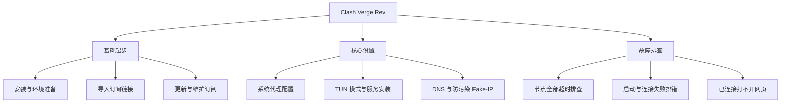

# Clash Verge / Clash Verge Rev 知识树

<AnswerBox question="什么是 Clash Verge Rev？它和传统的 Clash 有什么区别？">
Clash Verge Rev 是基于 Tauri 框架开发的现代化开源代理客户端。它内置了性能更强、协议支持更广泛的 **Mihomo (原 Clash.Meta)** 内核，界面美观、内存占用小，并且原生支持一键开启 TUN 虚拟网卡模式。
</AnswerBox>

---

## 🌲 核心知识架构与导航

---

## 📖 文章索引

### 1. 基础安装与订阅管理
- **[下载与安装配置](/clients/clash-verge/install)**：Windows / macOS 安装包选择与环境依赖。
- **[导入订阅链接](/clients/clash-verge/import-subscription)**：快速导入机场订阅与生成本地 Profile。
- **[更新与维护订阅](/clients/clash-verge/update-subscription)**：设置自动定时更新与手动刷新。

### 2. 核心网络功能配置
- **[系统代理开启与端口设置](/clients/clash-verge/system-proxy)**：标准 HTTP/SOCKS5 端口与系统代理接管。
- **[TUN 模式启用与驱动安装](/clients/clash-verge/tun-mode)**：接管不走系统代理的命令行与游戏流量。
- **[DNS 与 Fake-IP 模式解析](/clients/clash-verge/dns)**：彻底避免 DNS 污染与解析延迟优化。

### 3. 故障排查手册
- **[节点全部超时 (Timeout)](/clients/clash-verge/node-timeout)**：系统时间不同步、内核异常或订阅过期的快速修复。
- **[启动或连接失败排查](/clients/clash-verge/connection-failed)**：端口冲突与内核服务未授权解决。
- **[连接成功但打不开网页](/clients/clash-verge/cannot-open-websites)**：分流规则冲突、TUN 虚拟网卡残留与系统代理清理。
