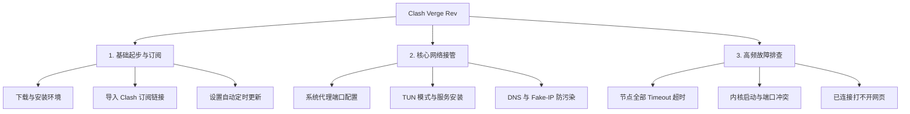

# Clash Verge / Clash Verge Rev 知识树与使用中心

<AnswerBox question="什么是 Clash Verge Rev？它和传统 Clash 有什么区别？">
Clash Verge Rev 是基于 Rust 与 Tauri 框架开发的现代化开源跨平台客户端，内置持续维护的 <strong>Mihomo（原 Clash.Meta）</strong> 内核。相比已停止维护的旧版 Clash for Windows，它原生支持 VLESS、Reality、Hysteria 2 与 TUIC 等现代协议，内存占用更低，并可一键安装服务开启 TUN 虚拟网卡。
</AnswerBox>

---

## ⚡ 新手高频直达入口（先解决最常卡住的 3 件事）

1. **拿到订阅链接准备开始用？** ➔ 直达 [Clash Verge 订阅怎么导入（含订阅链接格式校验）](/clients/clash-verge/import-subscription)
2. **订阅列表节点需要刷新或自动同步？** ➔ 直达 [Clash Verge 手动与自动更新订阅教程](/clients/clash-verge/update-subscription)
3. **测速全部显示 Timeout / 全红或打不开网页？** ➔ 直达 [Clash Verge 节点全部超时 (Timeout) 排查](/clients/clash-verge/node-timeout)

---

## 🌲 核心知识架构与学习路径

---

## 📖 分阶段完整教程目录

### 1. 安装与订阅配置
- **[下载与安装配置](/clients/clash-verge/install)**：Windows (x64/ARM64) 与 macOS (Apple Silicon/Intel) 安装包区分与 WebView2 环境准备。
- **[Clash Verge 订阅导入与链接获取](/clients/clash-verge/import-subscription)**：从复制订阅 URL、验证 YAML 格式到激活 Profile 并测速的完整四步操作。
- **[更新与维护订阅](/clients/clash-verge/update-subscription)**：设置 720/1440 分钟自动定时同步及解决更新失败。

### 2. 网络模式与 DNS 进阶设置
- **[系统代理开启与端口设置](/clients/clash-verge/system-proxy)**：混合端口（Mixed Port 7897）作用及浏览器接管方式。
- **[TUN 模式启用与服务驱动安装](/clients/clash-verge/tun-mode)**：接管终端命令行、WSL、Docker 与不支持系统代理的游戏流量。
- **[DNS 与 Fake-IP 模式解析](/clients/clash-verge/dns)**：配置 `default-nameserver` 与增强模式彻底防范 DNS 污染。

### 3. 故障排查手册
- **[节点全部超时 (Timeout)](/clients/clash-verge/node-timeout)**：校准系统时钟、放行 `clash-meta` 内核与清除端口冲突。
- **[启动或连接失败排查](/clients/clash-verge/connection-failed)**：解决端口被占用、服务模式安装失败与内核崩溃。
- **[连接成功但打不开网页](/clients/clash-verge/cannot-open-websites)**：清理残留代理环境变量、排查规则分流走错通道与浏览器扩展抢占。

---

## 🎯 选型延伸：什么样的订阅更适配 Clash Verge？

并非所有服务商都能发挥 Mihomo 内核的全部潜力。若想了解服务商下发配置时应重点检查哪些策略组和协议支持，建议阅读 [Clash 适用的节点服务选型考量](/guides/clash-airport)，或前往 [2026 年度机场推荐专题](/recommend/) 按月付预算与线路对比挑选。
