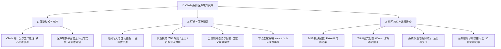

# Clash 系列客户端全景知识库 (Clash Hub)

<AnswerBox question="什么是 Clash 系列客户端？新手如何从零开始使用？">
Clash 是当今最主流的规则代理内核生态。 
<strong>新手入门标准流程</strong>：① 下载并安装 <strong>Clash Verge Rev</strong>；② 复制机场的 Clash 订阅链接并导入激活；③ 开启“系统代理”开关即可畅享高速上网。
</AnswerBox>

---

## 🧭 一、Clash 知识树全景导航

---

## 📑 二、Clash 独立教程完整目录

- **[Clash 是什么与工作原理深度解析](/clients/clash/what-is-clash)**：规则代理内核起源、底层架构与 2026 演进。
- **[Clash 客户端多平台下载与安装指南](/clients/clash/install)**：Windows / macOS / Android / iOS 安全版本矩阵。
- **[Clash 订阅导入与自动更新全指南](/clients/clash/subscription)**：URL 解析、定时更新与排错。
- **[Clash 代理模式详解](/clients/clash/proxy-mode)**：规则分流、全局代理与直连模式深入对比。
- **[Clash 分流规则语法与高级配置](/clients/clash/rules)**：DOMAIN / IP-CIDR / GEOIP 实战。
- **[Clash 节点选择策略与测速指南](/clients/clash/node-selection)**：select / url-test / fallback 策略组实战。
- **[Clash DNS 配置指南](/clients/clash/dns)**：Fake-IP 虚拟地址池原理与防污染 DoH。
- **[Clash TUN 模式实战配置](/clients/clash/tun-mode)**：Wintun 驱动、外服游戏 UDP 加速与常见报错。
- **[Clash 系统代理配置指南](/clients/clash/system-proxy)**：端口监听、快捷开关与退出断网排查。
- **[Clash 自动更新订阅设置](/clients/clash/update-subscription)**：定时更新、静默同步与失败排查。
- **[Clash 常见故障与排错大全](/clients/clash/troubleshooting)**：节点超时、连接失败、打不开网页速查。

---

## 🌟 三、2026 标配 Clash 一键导入旗舰专线机场推荐

选择全线标配企业级 IEPL 专线、VLESS 协议与 6 年稳定运营的旗舰服务商：

<AirportCard v-if="guangsu" :airport="guangsu" />
<AirportCard v-if="civet" :airport="civet" />
<AirportCard v-if="yuzhou" :airport="yuzhou" />

---

## 📚 关联知识图谱
- [2026 年度最佳机场推荐总榜](/recommend/)
- [核心代理协议全景技术百科](/protocols/)
- [2026 机场综合排行榜](/navigation/ranking)
