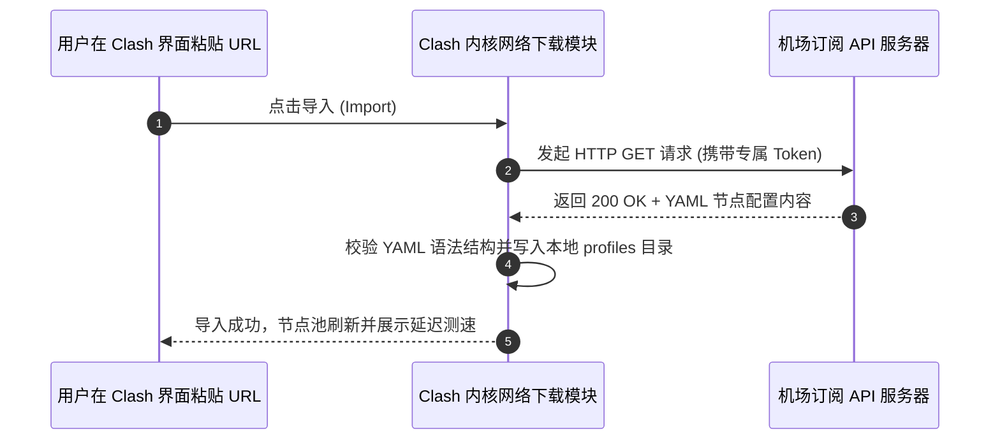

# Clash 订阅导入与自动更新全攻略

<AnswerBox question="怎么在 Clash 中正确导入机场订阅并设置自动更新？">
标准三步法： 
① <strong>复制订阅</strong>：登录机场后台复制专属 Clash 订阅链接； 
② <strong>导入配置</strong>：在 Clash Verge 中点击 `订阅 (Profiles)` ➔ 粘贴 URL ➔ 点击 `导入 (Import)` ➔ 点击切换激活此配置； 
③ <strong>配置自动更新</strong>：右键订阅配置卡片 ➔ 选择 `编辑信息` ➔ 将 `更新间隔` 设置为 <strong>720 分钟 (12 小时)</strong>。
</AnswerBox>

---

## ⚙️ 一、Clash 订阅下载与节点入库时序图

---

## 🛠️ 二、导入订阅高频报错与 30 秒排查

| 报错现象 | 故障根因 | 30 秒修复方案 |
| :--- | :--- | :--- |
| **`Invalid YAML format`** | 订阅被拦截返回了 HTML 网页而非配置 | 开启全局代理后再点导入，或联系机场客服 |
| **`Fetch failed (连接超时)`** | 本地宽带阻断了订阅 API 域名 | 开启一条旧节点或热点网络后再试 |
| **`Token Expired`** | 账户过期或在官网重置了订阅 Token | 登录官网重新复制最新生成的订阅链接 |

---

## 🌟 三、2026 标配全平台一键订阅的高速专线机场推荐

<AirportCard v-if="guangsu" :airport="guangsu" />
<AirportCard v-if="civet" :airport="civet" />

---

## 📚 关联技术图谱
- [订阅 (Subscription) 底层原理与格式解剖](/glossary/subscription)
- [更新订阅失败排查完整指南](/troubleshooting/subscription-update-failed)
- [2026 机场综合口碑排行榜](/navigation/ranking)
