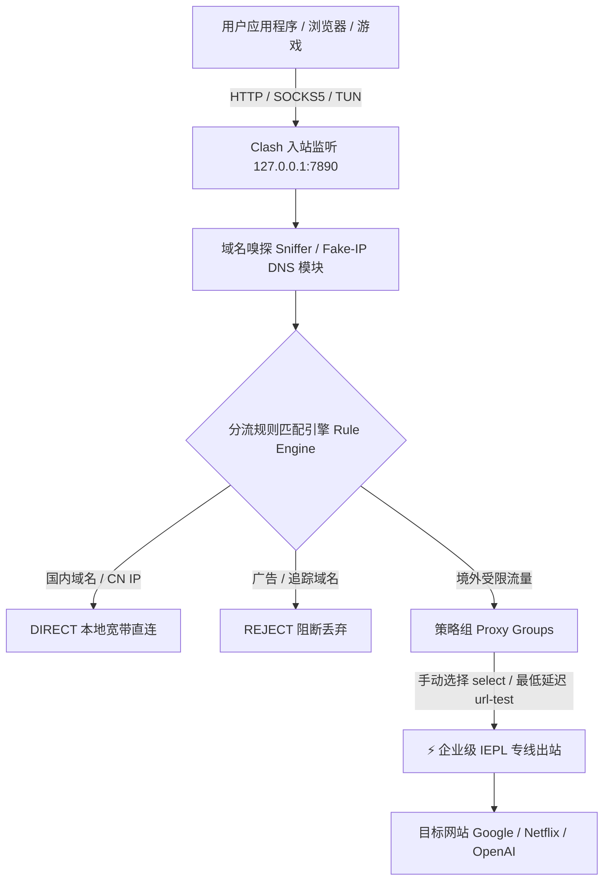

# Clash 是什么？- 规则代理内核起源、底层架构与 2026 演进

<AnswerBox question="Clash 到底是什么？它与 Clash Verge、CFW 等客户端有什么区别？">
Clash 本质上是一个<strong>基于 Go 语言开发的底层无图形界面（CLI / Daemon）网络代理核心 (Core)</strong>。
它通过统一的 YAML 配置文件管理入站流量监听、分流规则树（Rule Engine）、策略组调度（Proxy Groups）以及向海外服务器的出站转发。
日常所说的 <strong>Clash Verge、Clash for Windows (CFW)、ClashX、OpenClash</strong>，本质上都是在底层 Clash 核心外层封装了可视化图形界面（GUI）的应用程序。
</AnswerBox>

---

## 🏛️ 一、Clash 内核底层数据流向与架构图解



---

## 💡 二、Clash 改变代理软件的三大划时代技术创新

### 1. 分层分流规则引擎 (Rule Engine)
在 Clash 诞生前，传统代理软件只能“要么全局翻墙，要么黑白名单简陋切换”。Clash 引入了自顶向下的分层规则树：
- **`DOMAIN` 与 `DOMAIN-SUFFIX`**：基于域名后缀智能分流（如 `.google.com` 走海外，`.taobao.com` 走直连）；
- **`IP-CIDR` 与 `GEOIP`**：基于国内 MaxMind 离线 IP 库，确保国内 App 0 延迟且不耗费机场流量；
- **`PROCESS-NAME`**：指定特定软件（如 `Telegram.exe` 或外服游戏进程）强制走特定节点。

### 2. 多样化策略组调度机制 (Proxy Groups)
允许用户对节点进行灵活编组与自动化容灾：
- **`select`（手动选择）**：用户在界面任意切换当前国家或节点；
- **`url-test`（自动选择最低延迟）**：定期向 Google 发送握手请求，始终锁定延迟最低的节点；
- **`fallback`（故障自动转移）**：当主力节点故障时，毫秒级无感切换至备用节点；
- **`load-balance`（多节点负载均衡）**：将海量并发连接均匀分散到多条专线。

### 3. Fake-IP 零延迟 DNS 架构
在本地建立虚拟 IP 地址池（`198.18.0.0/16`），当浏览器发起查询时本地毫秒级秒回虚拟 IP，**彻底根治国内 DNS 污染，同时将域名解析延迟从 200ms 压缩至 0ms**。真实解析交由远端落地节点在海外服务器本地执行。

---

## 📜 三、Clash 历史演进与 2026 现状：从原版归档到 Mihomo (Meta) 时代

```
2018年               2020年                  2023年11月              2024~2026年
  │                    │                         │                       │
[Clash 开源诞生] ──▶ [Clash Premium 闭源版] ──▶ [原作者 Dreamacro 删库] ──▶ [Mihomo (虚空终端) 成为全球事实标准]
```

1. **2023 年停更事件**：原版 Clash 内核作者宣布删除并归档代码库，停止维护；
2. **Mihomo (Clash.Meta) 接棒成为现代主力**：
   - 社区全球开发者共同接盘演进为 **Mihomo 内核**；
   - 原生活跃支持 **VLESS、Reality、Hysteria 2、TUIC v5** 等所有现代前沿协议；
   - 2026 年主流客户端（如 **Clash Verge Rev**）已全面默认标配 Mihomo 内核。

---

## 🖥️ 四、2026 推荐的主流 Clash GUI 客户端选型矩阵

| 客户端名称 | 支持平台 | 适用人群 | 推荐指数 |
| :--- | :--- | :--- | :---: |
| **Clash Verge Rev** | **Windows / macOS / Linux** | **全平台电脑主力，界面现代，内置 Mihomo 内核** | ⭐⭐⭐⭐⭐ |
| **Flclash** | Windows / macOS / Android / iOS | Flutter 极简多端统一界面，跨平台体验一致 | ⭐⭐⭐⭐⭐ |
| **OpenClash** | OpenWrt 软路由 | 全屋家庭局域网透明网关，全设备免装客户端 | ⭐⭐⭐⭐⭐ |
| **Shadowrocket (小火箭)** | iOS / iPadOS | 苹果端独立原生客户端，完美兼容 Clash 订阅导入 | ⭐⭐⭐⭐⭐ |

---

## 🛠️ 五、初次使用 Clash 核心高频排错清单

| 常见故障现象 | 根本技术原因 | 30 秒排查解决方案 |
| :--- | :--- | :--- |
| **所有节点测速全部超时 (Timeout)** | 本地系统时钟误差超过 90 秒 | 进入系统设置点击“立即同步时钟” |
| **开启系统代理后浏览器仍打不开外网** | 浏览器使用了第三方代理插件（如 SwitchyOmega）冲突 | 将插件代理模式设置为“使用系统代理” |
| **退出客户端后电脑所有网页打不开** | 异常退出导致 Windows 注册表代理未复位 | 重新打开客户端正常退出，或在网络设置中关闭代理 |
| **打游戏/终端命令行不走代理** | 普通系统代理无法接管 UDP 与 CLI | 在客户端中开启 **[TUN 虚拟网卡模式](/glossary/tun-mode)** |

---

## 🌟 六、2026 完美适配 Clash / Mihomo 的高品质专线机场推荐

选择兼容 Clash 格式一键导入、提供全 IEPL 内网专线与 VLESS 协议的旗舰服务商：

<script setup>
import { airportsData } from '../../.vitepress/data/airportsData'
const guangsu = airportsData.find(a => a.id === 'guangsuyun')
const civet = airportsData.find(a => a.id === 'civetnet')
const yuzhou = airportsData.find(a => a.id === 'yuzhoucloud')
</script>

<AirportCard v-if="guangsu" :airport="guangsu" />
<AirportCard v-if="civet" :airport="civet" />
<AirportCard v-if="yuzhou" :airport="yuzhou" />

---

## 📚 关联知识图谱
- [Clash Verge Rev 客户端安装与使用全攻略](/clients/clash-verge/)
- [Clash / Mihomo 内核技术演进深度解析](/glossary/clash-core)
- [规则分流模式 (Rule Mode) 语法与配置](/glossary/rule-mode)
- [TUN 虚拟网卡模式配置实操](/glossary/tun-mode)
- [2026 机场综合口碑排行榜](/navigation/ranking)
