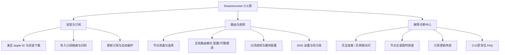

# Shadowrocket (小火箭) 知识树

<AnswerBox question="什么是 Shadowrocket（小火箭）？为什么 iOS 用户首选它？">
Shadowrocket 是一款运行在 iOS / iPadOS 上的多功能网络代理工具。它定价亲民（$2.99）、操作极其直观、支持扫码导入订阅与丰富的分流规则，并且协议兼容性极佳（支持 Shadowsocks、VLESS、Trojan、Hysteria2 等）。
</AnswerBox>

---

## 🌲 核心知识架构

---

## 📖 文章索引清单

### 1. 基础起步与订阅
- **[Shadowrocket 是什么与工作原理](/clients/shadowrocket/what-is-shadowrocket)**：解析 iOS 上的代理接管机制。
- **[iOS 下载与美区 Apple ID 安装教程](/clients/shadowrocket/install)**：如何准备外区账号并安全购买官方正版小火箭。
- **[导入订阅链接与二维码扫描](/clients/shadowrocket/import-subscription)**：快速拉取节点列表。
- **[更新订阅与自动更新设置](/clients/shadowrocket/update-subscription)**：下拉刷新与定时自动更新策略。

### 2. 路由分流与高级调优
- **[节点测速与智能选择](/clients/shadowrocket/select-node)**：连通性测试与低延迟节点切换。
- **[全局路由模式详解](/clients/shadowrocket/global-routing)**：配置模式、代理模式与直连模式的核心区别。
- **[分流规则与模块配置](/clients/shadowrocket/rules)**：自定义屏蔽广告、国内直连与分流策略。
- **[DNS 设置与防 DNS 泄漏](/clients/shadowrocket/dns)**：DoH/DoT 安全 DNS 调优。

### 3. 故障诊断与常见问题
- **[无法连接 / 无网络访问排查](/clients/shadowrocket/connection-failed)**：VPN 配置描述文件与权限重置。
- **[节点全部超时排查](/clients/shadowrocket/node-timeout)**：iOS Wi-Fi 代理冲突与时间同步排查。
- **[订阅更新失败解决办法](/clients/shadowrocket/subscription-failed)**：剪贴板权限与 Token 失效解决。
- **[Shadowrocket 综合问题 FAQ](/clients/shadowrocket/faq)**：常见高频提问与解答汇总。
