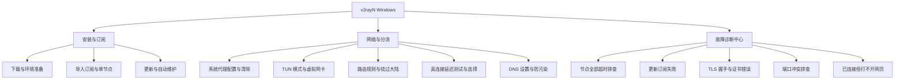

# v2rayN (Windows) 知识树

<AnswerBox question="什么是 v2rayN？它有哪些核心优势？">
v2rayN 是 Windows 平台上最经典成熟的开源 GUI 代理客户端。它支持 **Xray** 与 **sing-box** 双内核，兼容全量现代代理协议（VLESS, Reality, Trojan, Hysteria2, VMess 等），支持精准真连接延迟测试与深度的系统级 TUN 模式。
</AnswerBox>

---

## 🌲 v2rayN 完整知识架构

---

## 📖 文章索引清单

### 1. 基础安装与订阅管理
- **[下载、安装与环境准备](/clients/v2rayn/download-install)**：.NET 运行时依赖、Core 核心包与安装包选择。
- **[导入订阅链接与单节点](/clients/v2rayn/import-subscription)**：订阅分组添加与剪贴板节点解析。
- **[更新订阅与自动更新策略](/clients/v2rayn/update-subscription)**：不通过代理更新与定时拉取。

### 2. 核心网络与分流配置
- **[系统代理清除与设置](/clients/v2rayn/system-proxy)**：任务栏红蓝图标与 10809 端口接管机制。
- **[TUN 模式配置与使用](/clients/v2rayn/tun-mode)**：全局虚拟网卡与提升管理员权限。
- **[路由规则与绕过大陆 IP](/clients/v2rayn/routing)**：分流黑白名单与 GeoIP/GeoSite 规则集。
- **[真连接延迟与测速方法](/clients/v2rayn/test-latency)**：Ctrl+O 真连接与 Ctrl+R 测速技巧。
- **[活动服务器选择与切换](/clients/v2rayn/select-node)**：设为活动服务器与批量管理。
- **[DNS 服务器与防污染设置](/clients/v2rayn/dns)**：DoH/DoT 加密 DNS 与本地直连解析。

### 3. 故障排查手册
- **[节点全部超时解决办法](/clients/v2rayn/node-timeout)**：系统时间同步与 Xray 核心握手修复。
- **[连接失败排错清单](/clients/v2rayn/connection-failed)**：核心被杀毒软件误杀与权限不足。
- **[更新订阅失败排查](/clients/v2rayn/subscription-update-failed)**：直连死锁与 Base64 解码异常。
- **[TLS / 证书错误解决](/clients/v2rayn/tls-error)**：AllowInsecure 与 SNI 域名配置。
- **[本地端口冲突排查 (10808/10809)](/clients/v2rayn/port-conflict)**：排查端口被占用与修改监听端口。
- **[已连接但打不开网页](/clients/v2rayn/cannot-open-websites)**：系统代理未真正写入与浏览器扩展干扰。
- **[v2rayN 综合问题 FAQ](/clients/v2rayn/faq)**：高频使用问题与快捷键汇总。
