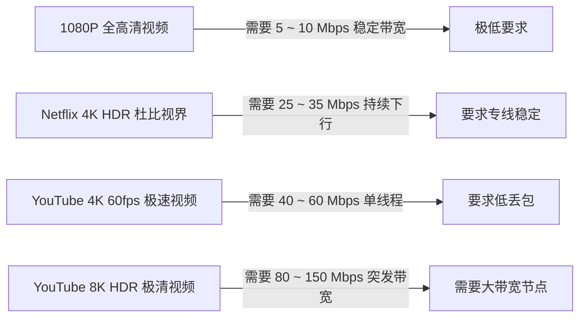

# 带宽 (Bandwidth) 深度解析

<AnswerBox question="什么是网络带宽？为什么测速能跑到 500M，看 YouTube 还是偶尔卡顿？">
带宽是指<strong>网络通道在单位时间内能够传输的最大数据吞吐容量（通常以 Mbps 为单位）</strong>。
测速跑满（如 Speedtest）通常使用的是<strong>多线程并发突发（Multi-Thread）</strong>，而看 YouTube / 拖拽 Netflix 进度条主要依赖<strong>单线程持续稳定下行带宽（Single-Thread）</strong>与<strong>链路丢包率</strong>。单线程不过关或链路存在丢包，即使标称千兆带宽依然会发生卡顿。
</AnswerBox>

---

## ⚙️ 一、带宽单位换算与下载速率对照

网络运营商和机场以**比特 (bit)** 计量，而操作系统下载文件以**字节 (Byte)** 显示：
$$1\text{ Byte} = 8\text{ bits}$$

| 标称带宽规格 | 理论最高下载速率 | 单线程 4K 视频秒开能力 | 适用场景 |
| :--- | :--- | :--- | :--- |
| **50 Mbps** | 约 $6.25\text{ MB/s}$ | ✅ 能够流畅播放 4K | 网页浏览、外贸邮件、日常查资料 |
| **100 Mbps** | 约 $12.5\text{ MB/s}$ | ✅ 极速秒开 4K，秒拖进度条 | 重度视频用户、高清直播 |
| **300 ~ 500 Mbps** | 约 $37.5\sim62.5\text{ MB/s}$ | 🚀 完美支持 8K HDR 与大文件下载 | 程序员拉取 Docker/Git，多设备共享 |
| **1000 Mbps (千兆)** | 约 $125.0\text{ MB/s}$ | 🏆 极客级满速体验 | 全屋旁路由软路由透明网关 |

---

## 🎬 二、主流流媒体与应用场景的真实码率需求

---

## 🛠️ 三、如何测出真实的节点单线程带宽？

1. **YouTube 详细统计信息 (Stats for Nerds)**：
   - 在 4K 视频上右键点击 `详细统计信息`，查看 `Connection Speed` 数值：
     - 若稳定在 $50,000\text{ Kbps} (50\text{ Mbps})$ 以上，4K 播放绝不卡顿；
     - 若剧烈波动且频繁跌破 $15,000\text{ Kbps}$，说明节点单线程冗余不足或链路丢包。
2. **Speedtest 单线程模式测试**：
   - 在 Speedtest 界面将 `Multi` 切换为 `Single` 进行测速。

---

## 🌟 四、2026 大带宽 4K/8K 极速专线机场推荐

<AirportCard v-if="guangsu" :airport="guangsu" />
<AirportCard v-if="civet" :airport="civet" />
<AirportCard v-if="sogo" :airport="sogo" />

---

## 📚 关联技术百科
- [YouTube 详细统计信息与 4K 卡顿调优](/scenarios/youtube)
- [Netflix 4K 流媒体解锁机场精选](/recommend/streaming-airport)
- [2026 机场综合口碑排行榜](/navigation/ranking)
