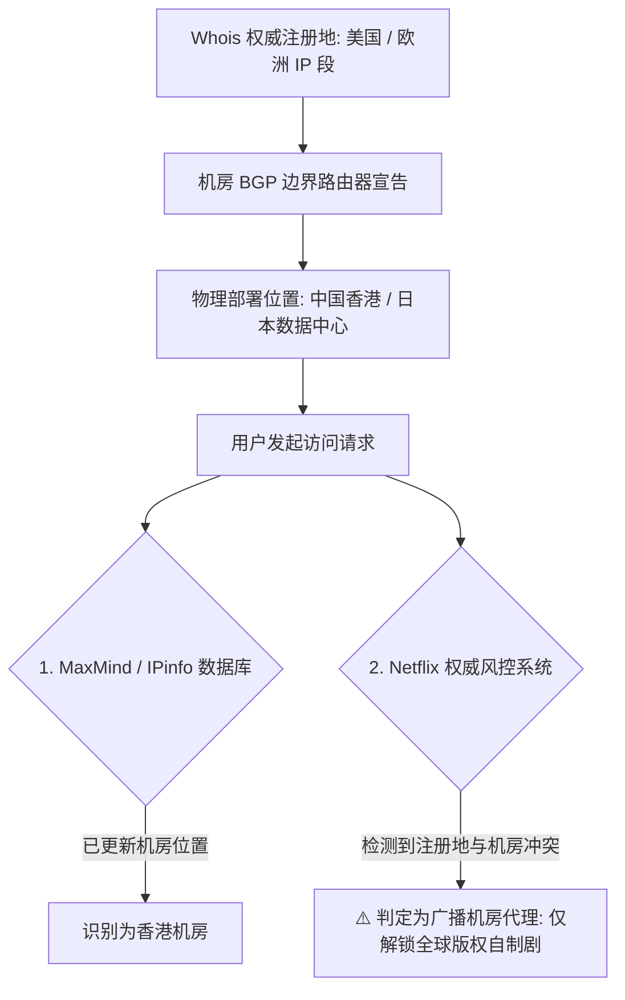

# 广播 IP (Broadcast IP) 深度解析

<AnswerBox question="什么是广播 IP（播报 IP）？为什么广播 IP 经常看不了 Netflix 非自制剧？">
广播 IP 是指<strong>原本在区域互联网注册机构（如 ARIN/RIPE）注册归属于 A 国家（如美国或欧洲）的 IP 地址段，通过 BGP Anycast / 跨域宣告技术，在 B 国家（如中国香港或日本）的物理机房服务器上进行跨区路由宣告并使用的 IP</strong>。
由于很多流媒体（Netflix/Disney+）和银行平台的地理风控数据库存在更新时差或识别到“注册地与机房实际位置不符”，会判定该 IP 为商业数据中心广播，从而<strong>降级限制访问（例如 Netflix 仅允许观看自制剧）</strong>。
</AnswerBox>

---

## ⚙️ 一、广播 IP 跨区宣告底层机制图解

---

## 🆚 二、广播 IP vs 原生 IP 核心对比表

| 对比维度 | 广播 IP (Broadcast IP) | 原生 IP (Native IP) |
| :--- | :--- | :--- |
| **Whois 注册地 vs 机房位置** | ❌ **不一致（跨区宣告）** | **✅ 100% 完全一致** |
| **IP 采购与运营成本** | **较低**（利用闲置跨国 IP 段广播） | **较高**（本土稀缺原生资源） |
| **Netflix 流媒体解锁** | ⚠️ 仅解锁自制剧 (Global Only) | **🏆 解锁全量非自制剧 (Full Catalog)** |
| **Google 搜索定位** | 经常跳往其他注册国家 | 稳定定位当前所在国家与语言 |
| **大文件下载与日常网页** | **完全不受影响，速度极快** | 完全不受影响，速度极快 |

---

## 🔍 三、如何快速识别当前节点是否为广播 IP？

1. **Bgp.he.net 路由源查询**：
   - 访问 `https://bgp.he.net/`，输入节点出口 IP；
   - 检查 `Routing (BGP Route)` 宣告的 AS 号与其原始 `Whois Record` 注册国家是否一致。
2. **Netflix 限制剧目直测**：
   - 打开 Netflix 搜索《绝命毒师 (Breaking Bad)》或《行尸走肉 (The Walking Dead)》等非自制剧：
     - 若能正常搜索并播放，说明该 IP 具备**原生解锁能力**；
     - 若搜不到任何非自制剧，说明该 IP 属于**受限广播 IP**。

---

## 🌟 四、2026 标配高纯度原生 IP 专线机场推荐

针对追求 Netflix 4K 全剧集解锁与 ChatGPT 畅享的用户，推荐选用具备原生落地资源的服务商：

<AirportCard v-if="guangsu" :airport="guangsu" />
<AirportCard v-if="sogo" :airport="sogo" />

---

## 📚 关联技术百科
- [原生 IP 与广播 IP 区别深度解析](/network/native-vs-broadcast-ip)
- [Netflix 为什么只能看自制剧？](/scenarios/netflix)
- [2026 机场综合口碑排行榜](/navigation/ranking)
