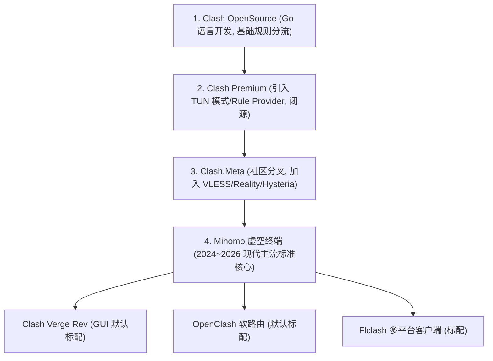

# Clash / Mihomo 内核深度解析

<AnswerBox question="什么是 Mihomo (Clash Meta) 内核？它与原版 Clash 有何关系？">
原版 Clash (由 Dreamacro 主导开发) 在 2023 年 11 月停止维护并归档代码库。
全球开源社区在原版基础上深度演进出了<strong>Mihomo（原名 Clash.Meta，虚空终端）开源内核</strong>。Mihomo 不仅 100% 完美向后兼容原版 Clash 的所有 YAML 配置文件与规则语法，更原生活跃支持了<strong>VLESS、Reality、Hysteria 2、TUIC v5、WireGuard、Sniffer 智能域名嗅探与 ECH</strong>等几乎所有现代前沿协议。
</AnswerBox>

---

## 📜 一、Clash 内核历史演进脉络

---

## 🆚 二、原版 Clash vs 现代 Mihomo (Meta) 核心技术特性全景对比

| 技术特性支持 | 原版 Clash 闭源 Core | 现代 Mihomo (Clash.Meta) Core |
| :--- | :---: | :---: |
| **VLESS 协议 (XTLS Vision)** | ❌ 不支持 | **✅ 原生完全支持** |
| **Reality 借用证书免配置** | ❌ 不支持 | **✅ 原生完全支持** |
| **Hysteria 2 协议 (魔改 UDP)** | ❌ 不支持 | **✅ 原生完全支持** |
| **TUIC v5 协议** | ❌ 不支持 | **✅ 原生完全支持** |
| **WireGuard / Shadowsocks 2022** | ❌ 部分不支持 | **✅ 原生完全支持** |
| **Sniffer 域名嗅探 (TLS/HTTP/QUIC)** | ⚠️ 功能简陋 | **🏆 深度智能嗅探，防 DNS 污染** |
| **社区活跃度与 CVE 安全补丁** | ❌ 已停更归档 | **🔥 全球开源社区每周高频迭代** |

---

## 🛠️ 三、在主流客户端中确认与切换 Mihomo 内核

### 1. Clash Verge Rev
- 进入 `设置` ➔ `Clash 内核` ➔ 确认当前选择为 **`Mihomo (Meta)`**（新版客户端默认即为 Mihomo）。

### 2. OpenClash (软路由)
- 进入 OpenClash 后台 ➔ `版本更新` ➔ 将 `Meta 内核` 设为默认运行内核，享受对 VLESS 与 Hysteria 2 节点的完整解析。

---

## 🌟 四、2026 标配现代 Mihomo / VLESS-Reality 的专线机场推荐

<AirportCard v-if="guangsu" :airport="guangsu" />
<AirportCard v-if="yuzhou" :airport="yuzhou" />
<AirportCard v-if="civet" :airport="civet" />

---

## 📚 关联技术百科
- [Clash Verge Rev 客户端新手安装与配置全攻略](/clients/clash-verge/)
- [VLESS 与 Reality 协议技术百科](/protocols/reality)
- [2026 机场综合口碑排行榜](/navigation/ranking)
