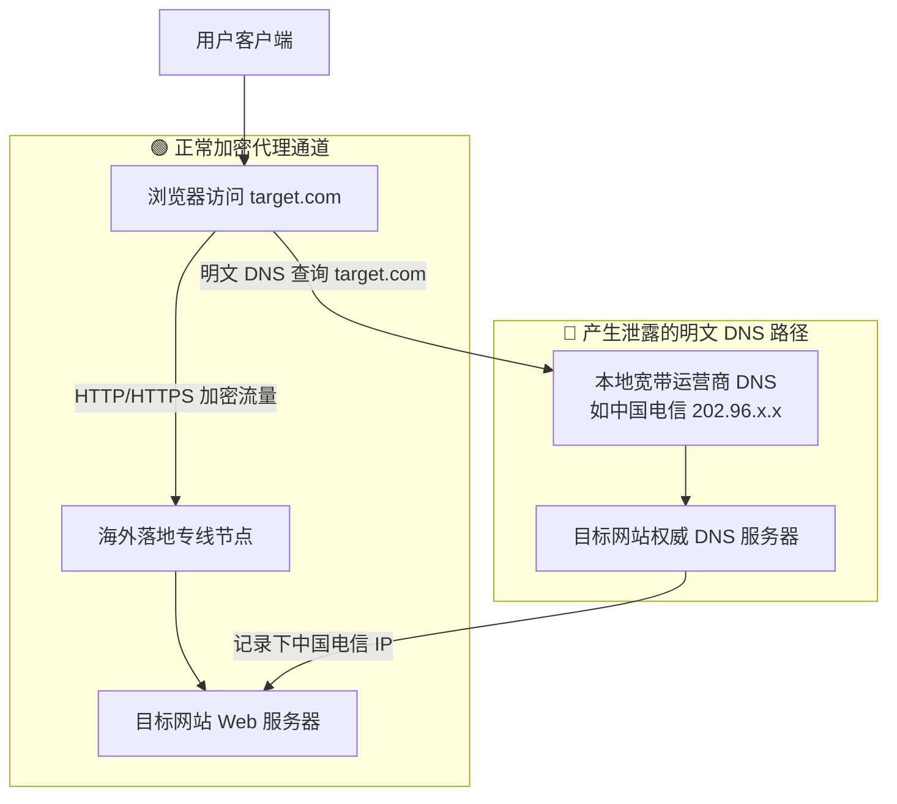

# DNS 泄露 (DNS Leak) 深度解析

<AnswerBox question="什么是 DNS 泄露？为什么开启了代理仍然会暴露真实物理所在地？">
DNS 泄露是指<strong>虽然用户的 HTTP/HTTPS 网页数据流量经过了加密代理节点转发，但操作系统的域名解析请求（DNS）却由于配置缺陷，仍然通过本地宽带运营商（如本地电信/联通/移动的 DNS 服务器）以明文方式发送出去的现象</strong>。
目标网站通过分析发起 DNS 解析查询的来源 IP，就能精准获知用户的真实国家、城市甚至宽带运营商。
</AnswerBox>

---

## 🔍 一、DNS 泄露的产生机制图解

---

## 🧪 二、如何自测与排查是否存在 DNS 泄露？

1. **访问权威检测网站**：打开 `https://www.dnsleaktest.com/` 或 `https://browserleaks.com/ip`。
2. **点击 `Extended Test` 完整测试**：
   - **安全状态**：列表中显示的 DNS 服务器全部位于海外（如 Cloudflare, Google, 落地机房所在国）。
   - **泄露状态**：列表中赫然出现了**中国电信 (China Telecom)、中国联通 (China Unicom) 或中国移动 (China Mobile)** 的服务器 IP。

---

## 🛡️ 三、彻底杜绝 DNS 泄露的三大配置方案

### 1. 客户端全面启用 Fake-IP 模式
在 Clash Verge、sing-box 中将 DNS 运行模式设置为 `fake-ip`。所有境内发出的域名解析直接在本地转化为保留虚拟 IP，真实 DNS 请求 100% 移交给远端代理服务器在海外本地完成。

### 2. 禁用 WebRTC 真实 IP 探测
某些网站会利用 WebRTC 的 STUN 协议绕过系统代理探测本地内网真实公网 IP。建议在浏览器中安装 WebRTC Control 插件或在客户端中开启 WebRTC 屏蔽。

### 3. 配置 Nameserver Policy 严格分流
确保所有境外域名（如 `geosite:geolocation-!cn`）严格仅允许通过 DoH/DoT 经由代理节点发送，杜绝任何明文泄露。

---

## 🌟 四、2026 高安全性与流媒体原生专线机场推荐

<AirportCard v-if="guangsu" :airport="guangsu" />
<AirportCard v-if="sogo" :airport="sogo" />

---

## 📚 关联技术百科
- [DNS 污染原理与 Fake-IP 机制](/glossary/dns-pollution)
- [原生 IP 与住宅 IP 详细区别](/network/native-ip)
- [2026 机场综合口碑排行榜](/navigation/ranking)
