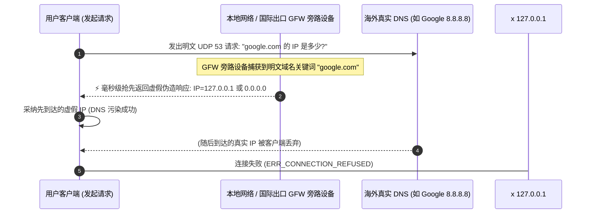

# DNS 污染 (DNS Pollution) 深度解析

<AnswerBox question="什么是 DNS 污染？它是如何导致海外网站打不开的？">
DNS 污染（又称域名劫持/投毒）是指<strong>审查系统在国际出口网关上部署旁路监听设备，监测到用户向海外 DNS 发出未加密的 UDP 53 端口查询请求时，利用地理物理链路更近的优势抢先伪造返回一个错误的虚假 IP 地址</strong>。
客户端接收到该虚假响应后，便会向错误的 IP 发起连接，直接导致连接超时或无法打开网页。
</AnswerBox>

---

## ⚙️ 一、DNS 污染的旁路抢答工作流程

---

## 🛡️ 二、现代客户端对抗 DNS 污染的四大核心技术

### 1. Fake-IP (虚拟保留 IP 池) 技术
- **原理**：Clash / Mihomo 在本地建立一个保留网段（如 `198.18.0.0/16`）。当浏览器发起 DNS 查询时，客户端直接秒回一个本地虚拟 IP（如 `198.18.0.2`）。
- **优势**：本地完全无需向任何远程服务器查询真实 IP，**从根本上彻底杜绝了 DNS 污染与查询等待延迟**。真正的域名解析由远端境外落地节点在海外服务器本地执行。

### 2. DoH (DNS over HTTPS) 与 DoT (DNS over TLS)
- **原理**：将 DNS 查询数据包封装进标准的 HTTPS (TCP 443) 或 TLS 握手中，审查系统无法窃听查询内容，无法发起针对性的抢答。

### 3. Smart DNS 智能国内外分流
- **国内域名**：走本地阿里 DNS (`223.5.5.5`) 或腾讯 DNS (`119.29.29.29`)，保证国内服务 CDN 就近解析秒开。
- **境外域名**：通过加密代理通道查询 Cloudflare (`1.1.1.1`) 或 Google (`8.8.8.8`)。

---

## 🛠️ 三、高频 DNS 故障排查表

| 常见报错现象 | 根本原因 | 30 秒快速修复方案 |
| :--- | :--- | :--- |
| **`DNS_PROBE_FINISHED_NXDOMAIN`** | 系统本地 DNS 缓存污染 | 执行 `ipconfig /flushdns` 清除本地 DNS 缓存 |
| **打得开 Google 但国内网站变慢** | 国内域名误走了海外 DNS 解析 | 检查客户端 DNS 设置，确保配置了国内 NameServer |
| **微信打得开但网页全部打不开** | DNS 53 端口被拦截或未配置 DoH | 开启客户端内的 **Fake-IP** 或 **TUN 模式** |

---

## 🌟 四、2026 高可用防污染专线机场精选

<AirportCard v-if="guangsu" :airport="guangsu" />
<AirportCard v-if="yuzhou" :airport="yuzhou" />

---

## 📚 关联技术百科
- [DNS 报错与打不开网页排查指南](/troubleshooting/dns-error)
- [Clash Verge DNS 高级分流配置教程](/clients/clash-verge/dns)
- [2026 机场综合口碑排行榜](/navigation/ranking)
