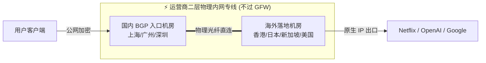

# IEPL 内网专线 (IEPL Private Line) 深度解析

<AnswerBox question="什么是 IEPL 专线？为什么它能做到晚高峰 0 丢包且不受 GFW 干扰？">
IEPL 是指<strong>跨国电信运营商（如中国电信国际 CTG、中国移动国际 CMI、PCCW）提供的二层以太网物理内网私网专线</strong>。
数据在国内机房接入后，直接在运营商封闭的物理光纤网内跨界传输至海外机房，<strong>全程完全不经过公网 GFW 防火墙与拥堵的公网国际出口</strong>，因此能够实现晚高峰恒定 0 丢包与毫秒级稳定低延迟。
</AnswerBox>

---

## ⚙️ 一、IEPL 专线物理网络拓扑

---

## 📊 二、IEPL 专线 vs 普通中转 vs 公网直连实测对比

| 指标维度 | 公网直连节点 | 普通公网中转 | IEPL 内网物理专线 |
| :--- | :--- | :--- | :--- |
| **物理链路** | 走公网国际出口，过 GFW | 国内中转，公网跨境隧道 | **运营商二层物理专线** |
| **晚高峰丢包率** | 10% ~ 40% (严重拥堵) | 1% ~ 5% (有轻微抖动) | **恒定 0% ~ 0.2%** |
| **GFW 抗封锁能力** | 极弱（IP/端口极易被墙） | 较强（需频繁更换中转） | **极强（数据不过墙，永不断连）** |
| **物理网络抖动 (Jitter)** | $> 50\text{ ms}$ | $10\sim20\text{ ms}$ | **$< 1\text{ ms}$** |
| **适用场景** | 仅适合轻度备用 | 日常网页与流媒体 | **外服联机游戏、Zoom 会议、4K 极速、商务主力** |

---

## 🎯 三、如何辨别真假 IEPL 专线？

市场上部分平价商家会用“普通公网中转隧道”假冒“IEPL 专线”宣传。可以通过以下技术手段辨别：

1. **晚高峰 20:00~23:00 丢包率与测速**：
   - 真实 IEPL 专线在晚高峰时期 Ping 丢包率依然为 0%，速度曲线呈平稳直线；
   - 虚假中转在晚高峰由于公网跨国出口拥堵，延迟会暴增且丢包率明显上升。
2. **路由追踪 (Traceroute) 特征**：
   - 专线在内部通常只有 1~2 跳内网私有 IP（如 `10.x.x.x` 或 `192.168.x.x`），不会出现公网骨干路由跳数。

---

## 💎 四、2026 年度精选 IEPL 专线机场推荐

挑选专线机场的核心在于**专线冗余带宽是否充足**与**是否提供支持月付降低门槛**：

<AirportCard v-if="guangsu" :airport="guangsu" />
<AirportCard v-if="sogo" :airport="sogo" />
<AirportCard v-if="civet" :airport="civet" />

---

## 📚 关联技术百科
- [什么是 IPLC 专线？IEPL 与 IPLC 深度差异对比](/network/iepl-vs-iplc)
- [全 IEPL 专线高端机场专题推荐](/recommend/iepl-airports)
- [2026 机场综合口碑排行榜](/navigation/ranking)
