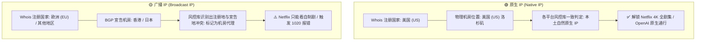

# 原生 IP (Native IP) 深度解析

<AnswerBox question="什么是原生 IP？为什么看 Netflix 非自制剧和用 ChatGPT 必须原生 IP？">
原生 IP 是指<strong>IP 地址在区域互联网注册管理机构（如 APNIC、ARIN、RIPE NCC）分配注册的归属国家，与该 IP 实际部署运行的物理服务器机房地理位置完全一致的 IP</strong>。
Netflix、Disney+、Hulu、OpenAI 等平台依靠权威 IP 地理数据库进行区域合规校验。只有原生 IP 能够 100% 通过本土检测，解锁全部地区限制内容。
</AnswerBox>

---

## ⚙️ 一、原生 IP vs 广播 IP (播报 IP) 底层原理对比

---

## 🔍 二、如何精准检测一个节点是否为原生 IP？

1. **Bgp.he.net 权威路由查询**：
   - 访问 `bgp.he.net/ip/你的节点IP`，查看 `Origin AS` 归属与 `Routing/Registration Country` 是否统一。
2. **IPinfo.io 数据库校验**：
   - 查看 `Country` 与 `Hosting Provider`，确认其并未被标记为 `Anycast` 广播或多地冲突。
3. **流媒体专用检测脚本 (RegionRestrictionCheck)**：
   - 运行自动化流媒体检测，验证 `Netflix: Yes (Region: US/HK/JP/SG)` 是否包含全版权片源（如《绝命毒师》《老友记》）。

---

## 🎬 三、原生 IP 在主流场景的核心价值

| 使用场景 | 原生 IP 表现 | 非原生/广播 IP 表现 |
| :--- | :--- | :--- |
| **Netflix 流媒体** | **解锁全部非自制剧 (Full Catalog)** | 只能看自制剧 (Global Only) |
| **ChatGPT / Claude** | **秒速登录，极低验证码几率** | 频繁 1020 报错、触发 Cloudflare 5秒盾 |
| **TikTok 海外运营** | **推送精准本土目标国家流量** | 容易发生 0 播放或流量被限流 |
| **海外银行与支付** | **正常登录与绑定验证** | 触发风控拦截、冻结交易 |

---

## 🌟 四、2026 原生 IP 与流媒体解锁专用机场推荐

精选配备高纯度原生落地 IP、定期维护 DNS 解锁网关的专线服务商：

<AirportCard v-if="guangsu" :airport="guangsu" />
<AirportCard v-if="sogo" :airport="sogo" />
<AirportCard v-if="civet" :airport="civet" />

---

## 📚 关联技术百科
- [原生 IP 与广播 IP 区别深度解析](/network/native-vs-broadcast-ip)
- [Netflix 为什么只能看自制剧？解锁机制详解](/scenarios/netflix)
- [ChatGPT 专用原生节点机场推荐](/recommend/chatgpt-airport)
