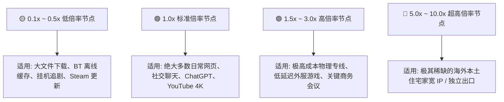

# 节点倍率 (Node Multiplier) 深度解析

<AnswerBox question="什么是节点计费倍率？它是如何扣除套餐流量的？">
节点倍率是指<strong>机场服务商对不同节点消耗用户套餐额度时所设定的计费乘数（通常在 0.1x ~ 5.0x 之间）</strong>。
计费公式为：
$$\text{实际扣除套餐流量} = \text{实际产生的网络流量 (上传 + 下载)} \times \text{节点倍率}$$
如果连接 $3.0\times$ 节点下载了 10GB 视频，套餐额度将被扣除 $30\text{ GB}$；而连接 $0.2\times$ 节点下载 10GB 视频，仅扣除 $2\text{ GB}$。
</AnswerBox>

---

## ⚙️ 一、不同倍率梯度的定位与适用场景

---

## ⚠️ 二、新手最容易踩的“流量偷跑”两大误区

### 误区 1：在 Clash 中开启了“自动选择 (URL-Test)”，却误包含了高倍率节点
- **风险**：自动选择策略组会测速挑选延迟最低的节点。由于高倍率专线节点延迟最低，客户端可能全程锁定在 $3.0\times$ 节点上，导致看一部 4K 电影就消耗了上百 G 流量。
- **避坑方案**：在配置文件中将自动选择的测试节点限定为 $1.0\times$ 的标准节点池。

### 误区 2：不区分上下行流量
- 绝大多数机场的计费是**上传流量 + 下载流量**双向合计扣费。在使用网盘上传大文件时，需注意双向流量乘算。

---

## 💡 三、极致性价比流量使用组合策略

1. **日常主力工作 / AI / 网页**：固定使用 **$1.0\times$ 标准 IEPL 专线节点**，速度极快且计费完全可控。
2. **下载大容量文件 / 系统镜像**：临时切换到 **$0.1\times \sim 0.2\times$ 廉价大流量节点**，以十分之一的成本完成下载。
3. **关键账号运营与防封**：使用专用低风控独立节点。

---

## 🌟 四、2026 套餐流量扎实 / 透明计费优质机场推荐

<AirportCard v-if="civet" :airport="civet" />
<AirportCard v-if="yifanyun" :airport="yifanyun" />
<AirportCard v-if="guangsu" :airport="guangsu" />

---

## 📚 关联技术百科
- [不限时按量付费备用机场推荐](/recommend/pay-as-you-go)
- [便宜高性价比月付机场精选](/recommend/cheap-airports)
- [2026 机场综合口碑排行榜](/navigation/ranking)
