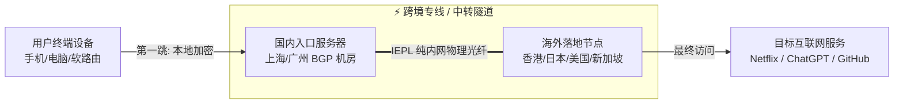

# 节点 (Node) 深度解析与架构全景

<AnswerBox question="什么是代理节点 (Node)？">
节点是指<strong>部署在远端机房中、运行着特定代理服务软件（如 Shadowsocks / VLESS / Trojan / Hysteria2）的服务器实例</strong>。
用户的客户端将本地加密的网络请求发送到该节点，由节点作为“中转代表”向目标网站（如 Google、YouTube、OpenAI）发起请求并将响应数据原路加密传回给用户。
</AnswerBox>

---

## ⚙️ 一、节点在网络链路中的底层拓扑



---

## 🔬 二、一条代理节点的关键技术参数解剖

以现代主流的 **VLESS 协议节点** 为例，其核心配置参数包含以下六大要素：

```json
{
  "tag": "🇭🇰 香港 IEPL 01 (专线)",
  "server": "hk01.example-airport.com",
  "server_port": 443,
  "type": "vless",
  "uuid": "8a7c29e8-4f3d-4abb-d10c-1fb07c9c0001",
  "flow": "xtls-rprx-vision",
  "tls": {
    "enabled": true,
    "server_name": "hk01.example-airport.com",
    "reality": {
      "enabled": true,
      "public_key": "x7bF9...",
      "short_id": "01af"
    }
  }
}
```

1. **Server (服务器地址)**：连接入口的域名或 IP；
2. **Port (端口)**：常用 443 (HTTPS) 或 80，伪装度高；
3. **UUID (用户鉴权密钥)**：36 字符的标准身份标识，杜绝非法蹭网；
4. **Flow / Security (传输流控与加密)**：如 `xtls-rprx-vision`（直接把加密数据原样交给 TLS 栈，速度极快）；
5. **Reality (伪装目标)**：借用合规白名单网站的 TLS 证书，使 GFW 主动探测无法识别。

---

## 🌐 三、常见节点类型与地区选择指南

| 节点国家 / 地区 | 物理往返延迟 | 核心优势与适用场景 |
| :--- | :--- | :--- |
| **🇭🇰 中国香港 (HK)** | **15ms ~ 45ms (最低)** | 日常主力首选，Google 搜索、YouTube 4K 秒开，延迟最低 |
| **🇯🇵 日本 (JP)** | **30ms ~ 65ms** | 亚太流媒体、外服游戏 (Steam/日服手游)、动漫网站 |
| **🇸🇬 新加坡 (SG)** | **40ms ~ 75ms** | 东南亚业务、ChatGPT / Claude AI 首选（无地区限制） |
| **🇺🇸 美国 (US)** | **120ms ~ 180ms** | 原生 IP 覆盖最广，OpenAI 核心服务器所在地，TikTok 运营 |
| **🇹🇼 中国台湾 (TW)** | **35ms ~ 60ms** | 繁体中文流媒体（动画疯、Disney+ 中文字幕）、低延迟 |

---

## 🛠️ 四、节点全红 / 全部超时 (Timeout) 排查清单

遇到客户端中所有节点 Ping 测速全部显示 `Timeout` 或 `-1ms` 时：

1. **检查本地系统时间（90% 的原因）**：
   - VMess / VLESS 等协议要求客户端与服务器时间误差**不得超过 90 秒**。进入 Windows 设置 ➔ 点击 `立即同步时钟`。
2. **检查节点订阅是否已欠费或流量耗尽**：
   - 登录机场后台查看账户有效期与剩余流量。
3. **排查本地杀毒软件 / 防火墙**：
   - 检查火绒或 Windows Defender 是否拦截了客户端的核心进程（`clash-core` / `v2ray.exe`）。

---

## 🌟 五、2026 高质量稳定专线节点机场推荐

<script setup>
import { airportsData } from '../.vitepress/data/airportsData'
const guangsu = airportsData.find(a => a.id === 'guangsuyun')
const sogo = airportsData.find(a => a.id === 'sogoyun')
const civet = airportsData.find(a => a.id === 'civetnet')
</script>

<AirportCard v-if="guangsu" :airport="guangsu" />
<AirportCard v-if="sogo" :airport="sogo" />
<AirportCard v-if="civet" :airport="civet" />

---

## 📚 关联技术百科
- [什么是节点？新手详细指南](/start/what-is-node)
- [节点全部超时排查 30 秒清单](/troubleshooting/all-nodes-timeout)
- [全 IEPL 专线高端机场推荐](/recommend/iepl-airports)
