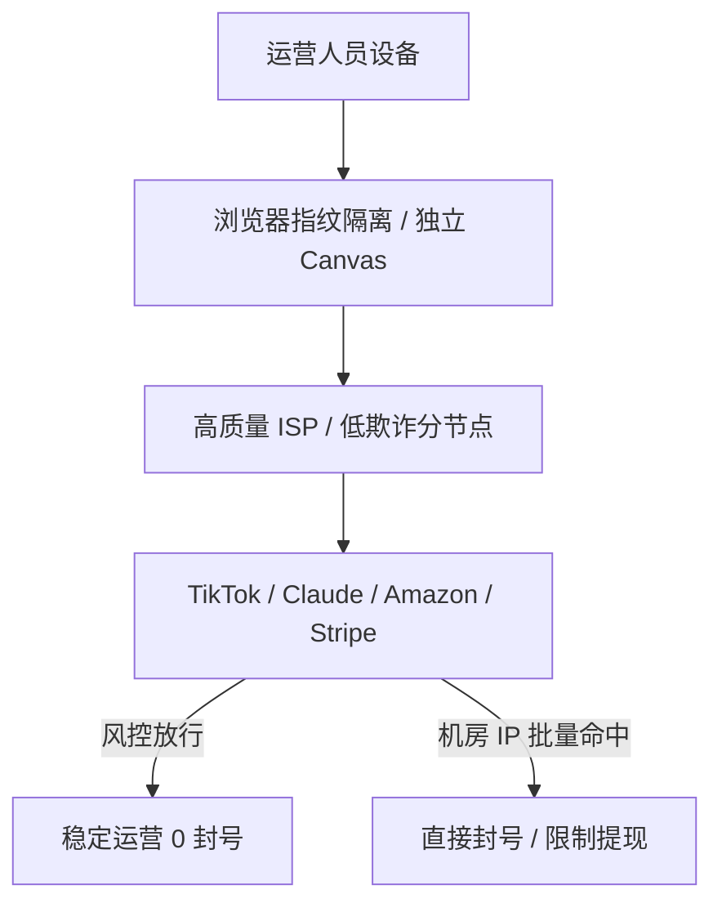

# 住宅 IP (Residential IP) 深度解析

<AnswerBox question="什么是住宅 IP (家宽 IP)？为什么跨境电商与高级 AI 账号极度依赖它？">
住宅 IP 是指<strong>由境外本土民用宽带运营商（如美国的 AT&T、Comcast、Verizon，香港的 HKT，日本的 NTT）直接分配给普通居民家庭网络使用的真实公网 IP</strong>。
在 IP 风控库中，其类型被标记为 <strong>ISP（互联网服务提供商）</strong>，而非 <strong>Datacenter（数据中心机房）</strong>。目标平台会将其视为真实的海外家庭个人用户，风控信任度极高。
</AnswerBox>

---

## ⚙️ 一、住宅 IP vs 数据中心机房 IP (Datacenter IP) 核心区别

| 对比维度 | 数据中心机房 IP (Datacenter) | 住宅家庭宽带 IP (Residential) |
| :--- | :--- | :--- |
| **IP 归属机构** | 云服务商 / 机房 (AWS, DigitalOcean, 阿里云) | **民用电信宽带 (AT&T, Comcast, HKT)** |
| **风控数据库标记** | `Hosting` / `DataCenter` (代理特征明显) | **`ISP` / `Residential` (真实个人家庭)** |
| **欺诈分 (Fraud Score)** | 普遍在 25 ~ 70 分 | **通常在 0 ~ 10 分 (极低风险)** |
| **带宽与稳定性** | 千兆高带宽，专线延迟极低 | 依赖民用上行，成本极高 |
| **最适业务场景** | 日常极速浏览、4K 视频、外服联机游戏 | **TikTok 跨境运营、跨境电商多店铺、Claude 防封号** |

---

## 🛡️ 二、跨境运营与 AI 防封号三大实战原则

1. **环境与 IP 严格一对一绑定**：切忌一个住宅 IP 登录几十个账号，避免产生连带风控关联。
2. **时区与 WebRTC 一致性**：系统时区、语言和浏览器 WebRTC 必须与 IP 所在国家完全匹配。
3. **分流策略**：主力大流量看视频依然建议使用 [IEPL 专线机场](/recommend/iepl-airports)，关键账号运营再走住宅独立节点，兼顾速度与成本。

---

## 🌟 三、2026 高纯度 / AI 场景优化专线机场推荐

<AirportCard v-if="sujie" :airport="sujie" />
<AirportCard v-if="guangsu" :airport="guangsu" />

---

## 📚 关联技术百科
- [IP 欺诈分深度判定指南](/glossary/fraud-score)
- [原生 IP 与住宅 IP 详细技术区别](/network/native-ip)
- [速界（AI 场景深度优化评测）](/reviews/sujie)
