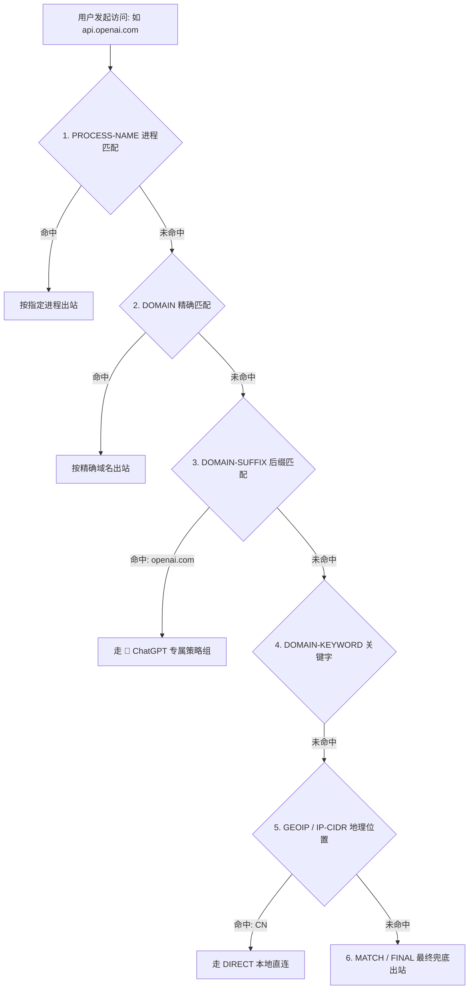

# 规则分流模式 (Rule Mode) 深度解析

<AnswerBox question="什么是规则分流模式 (Rule Mode)？">
规则分流模式是现代代理客户端（如 Clash、sing-box、Shadowrocket、Quantumult X）的<strong>智能出站流量调度中枢</strong>。
客户端依据预设的规则集（Rule Sets），在毫秒级内自动判断当前网络请求的目标：<strong>国内流量（如微信、淘宝、百度）自动走本地宽带直连（不耗费节点流量且无延迟）；境外受限流量（如 Google、YouTube、GitHub）自动走加密代理节点转发</strong>。
</AnswerBox>

---

## ⚙️ 一、规则匹配算法与自顶向下优先级顺序



- **严格自顶向下规则**：一旦某一行规则被率先命中，客户端立即执行该规则指定的出站行为（DIRECT / 节点 / 拒绝），**后续所有规则将不再被扫描计算**。

---

## 🔬 二、核心规则类型语法速查表

| 规则类型 (Rule Type) | 语法示例 | 匹配行为解释 |
| :--- | :--- | :--- |
| **`DOMAIN`** | `DOMAIN,www.google.com,PROXY` | 仅严格精确匹配 `www.google.com` 这一个完整域名 |
| **`DOMAIN-SUFFIX`** | `DOMAIN-SUFFIX,youtube.com,PROXY` | 匹配 `youtube.com` 及其所有子域名（如 `m.youtube.com`） |
| **`DOMAIN-KEYWORD`** | `DOMAIN-KEYWORD,netflix,PROXY` | 域名只要包含 `netflix` 字符串立即命中 |
| **`IP-CIDR`** | `IP-CIDR,192.168.1.0/24,DIRECT` | 匹配特定 IP 网段（常用于局域网内网直连） |
| **`GEOIP`** | `GEOIP,CN,DIRECT` | 依据 MaxMind 离线 IP 库，所有中国大陆 IP 一律走直连 |
| **`MATCH`** | `MATCH,🚀 节点选择` | 最终兜底规则，未被上述规则捕获的流量一律走此策略组 |

---

## 💡 三、规则提供者 (Rule Providers) 现代自动更新机制

现代 Clash 配置普遍采用 `rule-providers` 机制，客户端会自动从 GitHub 每天定期下载最新的白名单与黑名单规则：
```yaml
rule-providers:
  reject:
    type: http
    behavior: domain
    url: "https://testingcf.jsdelivr.net/gh/Loyalsoldier/clash-rules@release/reject.txt"
    path: ./ruleset/reject.yaml
    interval: 86400
```

---

## 🌟 四、2026 标配精细分流规则的高速专线机场推荐

<script setup>
import { airportsData } from '../.vitepress/data/airportsData'
const guangsu = airportsData.find(a => a.id === 'guangsuyun')
const civet = airportsData.find(a => a.id === 'civetnet')
const yuzhou = airportsData.find(a => a.id === 'yuzhoucloud')
</script>

<AirportCard v-if="guangsu" :airport="guangsu" />
<AirportCard v-if="civet" :airport="civet" />
<AirportCard v-if="yuzhou" :airport="yuzhou" />

---

## 📚 关联技术百科
- [Clash Verge 客户端使用指南](/clients/clash-verge/)
- [Shadowrocket 分流规则实操详解](/clients/shadowrocket/rules)
- [2026 机场综合口碑排行榜](/navigation/ranking)
