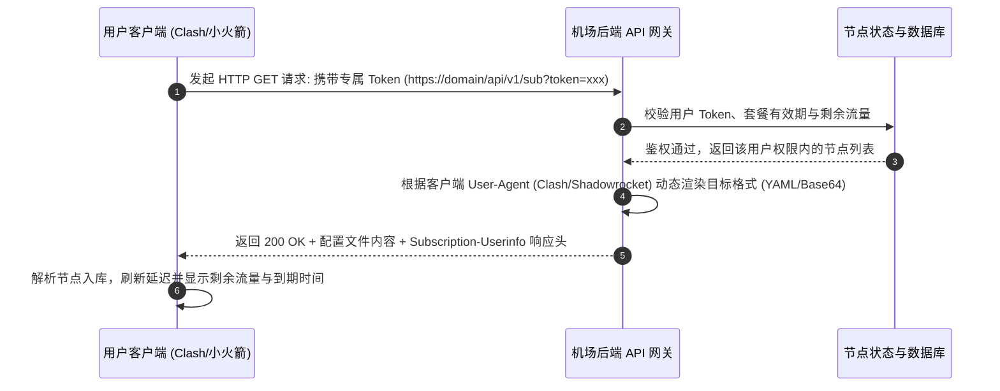

# 订阅 (Subscription) 深度解析与实战指南

<AnswerBox question="什么是订阅链接 (Subscription URL)？">
订阅链接是指<strong>服务商将包含全部节点服务器地址、端口、加密密钥、传输协议以及分流规则的完整配置，集中托管在固定 Web URL 地址上的动态分发机制</strong>。
客户端导入该 URL 后，只需点击“更新订阅”，即可在数秒内自动同步服务商后端最新维护的全部可用节点，无需手动单条添加。
</AnswerBox>

---

## ⚙️ 一、订阅链接的底层分发机制与时序流向



---

## 🔬 二、主流订阅数据格式与协议解剖

### 1. 通用 Base64 订阅 (v2rayN / Shadowrocket 格式)
- **原理**：将多条单节点 URI 链接（按行换行）进行标准 Base64 编码封装：
  ```
  # 解码前（订阅链接实际下发的内容）：
  dm1lc3M6Ly9leUowSWpva... (超长密文字符串)

  # Base64 解码后的原始明文数据：
  ss://YWVzLTI1Ni1nY206cGFzc3dvcmRAMS4yLjMuNDo4Mzg4#%F0%9F%87%AD%F0%9F%87%B0%20%E9%A6%99%E6%B8%AF%20IEPL%2001
  vless://uuid-1234-5678@node.domain.com:443?encryption=none&security=reality#%F0%9F%87%AF%F0%9F%87%B5%20%E4%B8%9C%E4%BA%AC%20%E4%B8%93%E7%BA%BF
  ```

### 2. Clash YAML 配置订阅
- **结构**：包含 `proxies`（节点池）、`proxy-groups`（策略组如自动选择/故障转移）、`rules`（分流规则）：
  ```yaml
  port: 7890
  socks-port: 7891
  mode: rule
  proxies:
    - name: "🇭🇰 香港 IEPL 01"
      type: vless
      server: hk01.domain.com
      port: 443
      uuid: 8a7c29e8-xxxx-xxxx-xxxx
      tls: true
      servername: hk01.domain.com
  proxy-groups:
    - name: 🚀 节点选择
      type: select
      proxies:
        - 🇭🇰 香港 IEPL 01
        - DIRECT
  rules:
    - GEOIP,CN,DIRECT
    - MATCH,🚀 节点选择
  ```

### 3. HTTP 响应头中的 User-Info 元数据
服务商在下发订阅文件时，会在 HTTP Header 中附带用户的套餐消费数据：
```http
Subscription-Userinfo: upload=1073741824; download=10737418240; total=161061273600; expire=1787046571
```
客户端解析此 Header 后，便会在界面直观展示已用流量、总配额与到期倒计时。

---

## 📱 三、主流客户端订阅导入与自动更新实操

### 1. Clash Verge Rev (Windows / macOS)
1. 复制机场官网提供的 `Clash 订阅链接`；
2. 打开 Clash Verge Rev，点击左侧 `订阅 (Profiles)`；
3. 在上方输入框粘贴订阅 URL，点击 `导入 (Import)`；
4. 右键订阅卡片，选择 `编辑信息` ➔ 开启 `定时更新 (建议设置为 720 分钟)`。

### 2. Shadowrocket 小火箭 (iOS)
1. 点击右上角 `+` 号；
2. 类型选择 `Subscribe (订阅)`；
3. 在 `URL` 栏中粘贴订阅地址，备注填写机场名称；
4. 点击右上角 `完成`，小火箭将自动下载节点列表。

---

## 🛠️ 四、高频订阅报错与排查方案表

| 报错提示 / 状态码 | 产生根本原因 | 30 秒排查与修复方案 |
| :--- | :--- | :--- |
| **`404 Not Found`** | 订阅 Token 变更或官网更换了订阅主域名 | 登录机场官网后台重新复制最新订阅链接 |
| **`500 / 502 Bad Gateway`** | 机场后端订阅转换服务器临时过载维护 | 等待 5~10 分钟重试，或联系客服获取备用转换节点 |
| **`SSL/TLS Certificate Error`** | 订阅域名证书过期或电脑系统时间未同步 | 校准系统本地时间，或在客户端设置中暂时关闭“校验证书” |
| **`Empty Response (空节点)`** | 账户欠费已过期，或套餐流量已全部耗尽 | 检查官网账户余额与流量包剩余额度 |
| **`直连无法更新 (连接超时)`** | 订阅服务器 API 域名被本地运营商临时阻断 | 先开启一条可用旧节点（或者开启代理软件全局）后再点更新 |

---

## 🌟 五、2026 支持全格式一键订阅的稳定专线机场推荐

挑选支持一键客户端导入、提供国内免翻墙快速更新订阅的高品质服务商：

<script setup>
import { airportsData } from '../.vitepress/data/airportsData'
const guangsu = airportsData.find(a => a.id === 'guangsuyun')
const civet = airportsData.find(a => a.id === 'civetnet')
const yuzhou = airportsData.find(a => a.id === 'yuzhoucloud')
</script>

<AirportCard v-if="guangsu" :airport="guangsu" />
<AirportCard v-if="civet" :airport="civet" />
<AirportCard v-if="yuzhou" :airport="yuzhou" />

---

## 📚 关联技术百科
- [订阅导入失败与格式转换全解析](/subscription/import-failed)
- [更新订阅失败排查完整步骤](/troubleshooting/subscription-update-failed)
- [2026 机场综合排行榜](/navigation/ranking)
