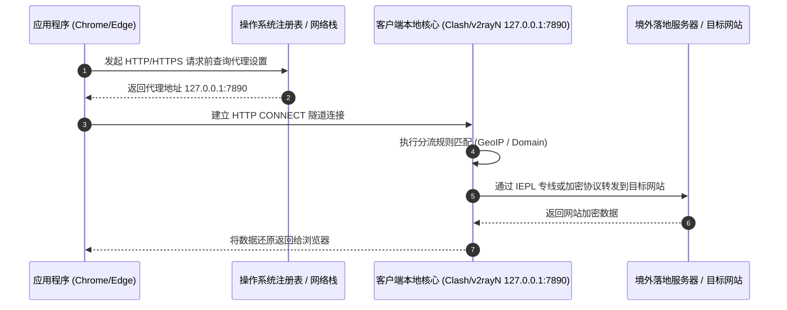

# 系统代理 (System Proxy) 深度解析

<AnswerBox question="什么是系统代理 (System Proxy)？">
系统代理是指<strong>代理客户端通过操作系统官方提供的网络代理 API（如 Windows WinINet 注册表、macOS Networksetup、GNOME Proxy），将本机的 HTTP / HTTPS / SOCKS 监听端口（默认通常为 127.0.0.1:7890）设置为系统的默认出站代理</strong>。所有遵循系统代理调用的浏览器和应用程序会自动将流量交由客户端进行加密分流。
</AnswerBox>

---

## ⚙️ 一、底层工作机制与数据流向

系统代理属于**应用层（Application Layer）网络代理**。它的工作流程如下：



---

## 🖥️ 二、分操作系统开启与验证方法

### 1. Windows 系统
- **配置路径**：`设置` ➔ `网络和 Internet` ➔ `代理` ➔ `手动设置代理`。
- **注册表底层键值**：
  ```
  HKEY_CURRENT_USER\Software\Microsoft\Windows\CurrentVersion\Internet Settings
  - ProxyEnable (1 为开启，0 为关闭)
  - ProxyServer (通常为 127.0.0.1:7890)
  ```
- **命令行验证**：
  ```powershell
  # 查看当前系统代理是否生效
  Get-ItemProperty -Path 'HKCU:\Software\Microsoft\Windows\CurrentVersion\Internet Settings' | Select-Object ProxyEnable, ProxyServer
  ```

### 2. macOS 系统
- **配置路径**：`系统设置` ➔ `网络` ➔ 选择当前 Wi-Fi/以太网 ➔ `详细信息` ➔ `代理` ➔ 勾选 `网页代理 (HTTP)` 和 `安全网页代理 (HTTPS)`。
- **终端快捷查看**：
  ```bash
  networksetup -getwebproxy "Wi-Fi"
  networksetup -getsecurewebproxy "Wi-Fi"
  ```

---

## ⚠️ 三、系统代理的三大固有局限与“不走代理”排查

并非所有软件都会遵守系统代理设置：

| 应用程序类型 | 是否默认走系统代理 | 解决方案 |
| :--- | :---: | :--- |
| **主流浏览器 (Chrome, Edge, Safari, Firefox)** | ✅ 是 | 开箱即用，自动遵循系统分流 |
| **日常聊天 (Telegram, Discord)** | ⚠️ 部分遵循 | 建议在软件内置设置中手动填入 SOCKS5 代理 `127.0.0.1:7890` |
| **命令行终端 (PowerShell, CMD, Bash, Git)** | ❌ 否 | 需配置环境变量 `set http_proxy=http://127.0.0.1:7890` |
| **外服游戏与语音 (Steam, Epic, Valorant)** | ❌ 否 (采用 UDP) | **必须开启 [TUN 虚拟网卡模式](/glossary/tun-mode)** |
| **UWP 应用 (Windows 应用商店 / WSL2)** | ❌ 默认回环隔离 | 需使用 Loopback 豁免工具解除本地回环网络限制 |

---

## 🛠️ 四、高频故障排查：关闭客户端后电脑无法上网

这是新手最常遇到的故障之一：**“退出 Clash/v2rayN 后，所有网页提示 ERR_PROXY_CONNECTION_FAILED”**。

### 故障根因
客户端在非正常退出（如强制杀进程、电脑突然关机）时，未能及时将 Windows 注册表中的 `ProxyEnable` 键值重置为 `0`。此时系统仍试图将所有流量发送给已经关闭的 `127.0.0.1:7890`，导致全网断连。

### 30 秒一键修复方案：
1. **重新打开客户端**，正常开启系统代理，然后再点击界面上的“正常退出”或“关闭代理”。
2. **手动重置**：进入 Windows `设置` ➔ `网络和 Internet` ➔ `代理` ➔ 关闭 `使用代理服务器` 按钮。
3. **PowerShell 快速复位命令**：
   ```powershell
   Set-ItemProperty -Path 'HKCU:\Software\Microsoft\Windows\CurrentVersion\Internet Settings' -Name ProxyEnable -Value 0
   ```

---

## 🌟 五、高可用专线机场选型推荐

系统代理只负责本地转发，实际访问速度与稳定性取决于远端节点的专线质量与协议性能：

<script setup>
import { airportsData } from '../.vitepress/data/airportsData'
const guangsu = airportsData.find(a => a.id === 'guangsuyun')
const yuzhou = airportsData.find(a => a.id === 'yuzhoucloud')
</script>

<AirportCard v-if="guangsu" :airport="guangsu" />
<AirportCard v-if="yuzhou" :airport="yuzhou" />

---

## 📚 关联技术百科
- [TUN 虚拟网卡模式深度指南](/glossary/tun-mode)
- [已连接代理但打不开网页排查](/troubleshooting/connected-but-no-internet)
- [2026 最新机场综合排行榜](/navigation/ranking)
