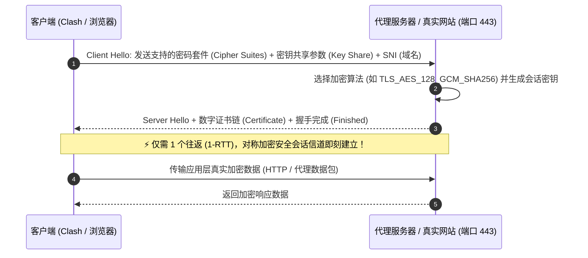

# TLS (Transport Layer Security) 深度解析

<AnswerBox question="什么是 TLS？为什么现代代理协议（如 Trojan / VLESS-Reality）全部依托 TLS？">
TLS（安全传输层协议，HTTPS 的核心底层）是<strong>在 TCP 传输层之上为网络通信提供机密性、完整性与双向身份鉴权的国际标准密码学协议</strong>。
现代代理协议通过完整复用或模拟合规的 TLS 1.3 握手，<strong>使代理流量在外部网络监听与防火墙审查眼中，与全球数以亿计的正规银行、电商、学术网站的标准 HTTPS 访问完全无异</strong>，从根本上终结了针对代理特征的模式识别。
</AnswerBox>

---

## ⚙️ 一、TLS 1.3 极速 1-RTT 握手时序图解

---

## 🔬 二、主流代理协议对 TLS 的演进与应用

### 1. Trojan 协议：真实证书完美伪装
- **原理**：为服务器申请合规的 Let's Encrypt 域名证书，代理客户端通过标准 TLS 443 端口连接。当非用户访问（如 GFW 主动探测）时，服务器直接展示真实的 Nginx 正常网站页面。

### 2. VLESS-Reality 协议：借用白名单大型网站证书（免证书时代）
- **突破性创新**：服务器无需自己购买域名和申请证书，直接**“借用 (偷用)”**境外大型知名网站（如 `www.apple.com`、`www.microsoft.com`）的合规 TLS 证书完成初始握手。
- **抗主动探测**：如果非法探测器发起握手，Reality 会直接将连接反向代理给真正的苹果或微软服务器，探测系统抓不到任何把柄。

---

## 🛠️ 三、高频 TLS 错误与排查方案表

| 常见 TLS 报错 | 产生根本原因 | 30 秒排查与解决方案 |
| :--- | :--- | :--- |
| **`certificate has expired`** | 节点服务器的 SSL 证书已过期 | 通知机场管理员更新证书，或在客户端临时关闭“校验证书” |
| **`certificate is not valid for any names`** | 客户端填写的 SNI 域名与证书实际绑定的域名不匹配 | 检查并重新导入最新订阅链接，修正 `servername` |
| **`x509: certificate signed by unknown authority`** | 本地系统缺少根证书，或局域网存在中间人抓包软件 | 安装最新根证书库，或关闭 Fiddler/Charles 等抓包工具 |
| **`TLS Handshake Timeout`** | 本地系统时钟与服务器时差超过 90 秒，或端口被拦截 | **同步本地 Windows/macOS 系统时钟** |

---

## 🌟 四、2026 标配 VLESS-Reality 与 TLS 专线机场推荐

<AirportCard v-if="guangsu" :airport="guangsu" />
<AirportCard v-if="yuzhou" :airport="yuzhou" />
<AirportCard v-if="civet" :airport="civet" />

---

## 📚 关联技术百科
- [TLS 证书错误排查完整指南](/troubleshooting/tls-error)
- [VLESS 与 Reality 协议技术解析](/protocols/reality)
- [Trojan 协议与伪装原理](/protocols/trojan)
