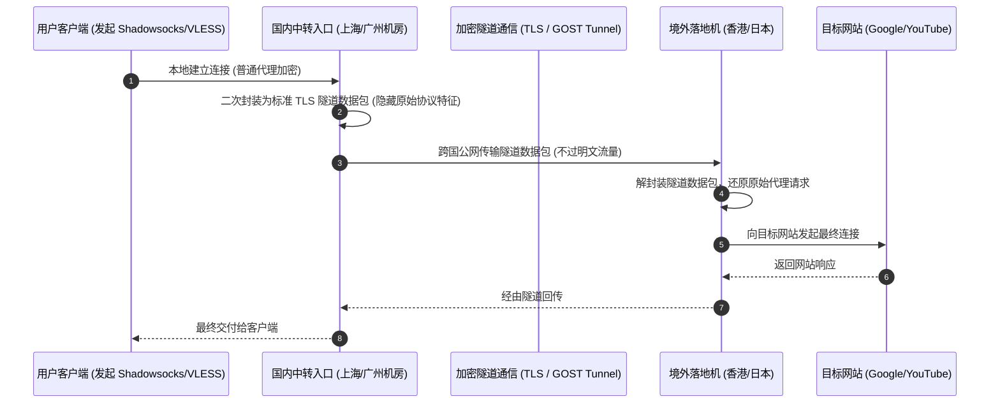

# 中转隧道 (Transit Relay) 深度解析

<AnswerBox question="什么是中转隧道 (Transit Relay)？">
中转隧道是指<strong>在用户和境外落地服务器之间，架设国内前置中转跳板机，并通过专有的双向加密隧道协议（如 GOST、TLS Tunnel、Wstunnel、Brook）将用户的代理数据包安全封装跨界转发的技术架构</strong>。
相比公网直连，中转隧道将不稳定的跨国公网连接分解为“国内高速连接 + 加密跨界传输”，大幅提升了抗封锁性与连接稳定性。
</AnswerBox>

---

## ⚙️ 一、中转隧道的数据流向与封装过程

---

## 🆚 二、中转隧道 vs 物理内网专线 vs 公网直连实测对比

| 指标维度 | 公网直连节点 | 普通公网加密中转 | IEPL / IPLC 物理专线 |
| :--- | :--- | :--- | :--- |
| **跨国链路属性** | 普通公网国际出口，过 GFW | 公网加密隧道，过 GFW | **运营商二层物理内网，不过 GFW** |
| **抗封锁能力** | 极弱（极易被主动探测封 IP） | **强（流量被隧道 TLS 二次伪装）** | **极强（物理隔离，永不被封）** |
| **晚高峰稳定性** | 极差（丢包率 20%~50%） | **良（偶有公网抖动 2%~5%）** | **🏆 极致稳定（恒定 0 丢包）** |
| **采购与使用成本** | 最低（白菜价） | **适中（月付 10~20 元高性价比）** | 较高（高端商务与游戏首选） |
| **适用人群** | 仅适合应急备用 | **广大学生党与追求性价比用户** | **主力办公、外服联机、4K 极客** |

---

## 🛠️ 三、主流中转隧道技术类型

1. **TLS / HTTPS 隧道**：将代理数据完全伪装为标准的 Web HTTPS 流量，抗封锁能力极强。
2. **WebSocket + TLS (WSS 隧道)**：支持借助 CDN（如 Cloudflare）进行免费中转加速。
3. **GOST 多跳中转**：支持级联中转与链式代理，常用于多机房入口调度。

---

## 🌟 四、2026 高性价比中转与专线混合机场推荐

<AirportCard v-if="yuzhou" :airport="yuzhou" />
<AirportCard v-if="v2yun" :airport="v2yun" />
<AirportCard v-if="guangsu" :airport="guangsu" />

---

## 📚 关联技术百科
- [中转线路技术原理详解](/network/transit)
- [IEPL 专线深度技术解析](/glossary/iepl)
- [便宜高性价比月付机场推荐](/recommend/cheap-airports)
