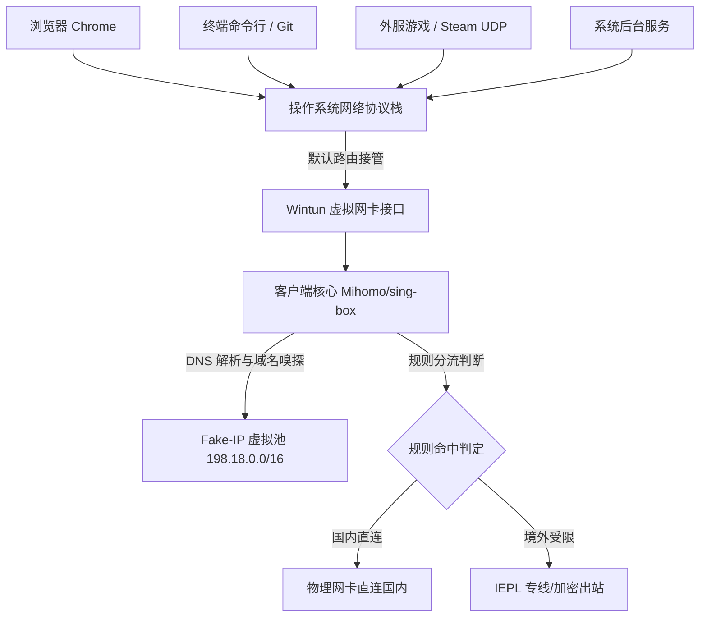

# TUN 虚拟网卡模式 (TUN Mode) 深度解析

<AnswerBox question="什么是 TUN 模式？为什么游戏联机与命令行开发必须开启 TUN？">
TUN 模式是指<strong>代理客户端在操作系统内核中安装一块虚拟三层网络适配器（如 Wintun 驱动），在 IP 网络层接管整台设备全部网络进出流量</strong>。
相比普通系统代理，TUN 模式能够 100% 捕获终端命令行、Steam 游戏、Discord 语音通话以及所有无原生代理设置软件的 TCP 与 UDP 数据包。
</AnswerBox>

---

## ⚙️ 一、TUN 模式架构与底层工作流

---

## 🆚 二、TUN 模式 vs 系统代理核心技术对比

| 核心维度 | 系统代理 (System Proxy) | TUN 虚拟网卡模式 (TUN Mode) |
| :--- | :--- | :--- |
| **OSI 网络层级** | 应用层 (Layer 7 HTTP/SOCKS) | **网络层 (Layer 3 IP Packet Layer)** |
| **UDP 协议支持** | ❌ 默认不支持 UDP | **✅ 原生完美支持 UDP (游戏/语音)** |
| **软件捕获率** | 约 60% (仅支持系统代理 API 的软件) | **100% 全系统所有软件与进程** |
| **DNS 劫持防污染** | 依赖浏览器 DoH | **由内核接管，彻底根治 DNS 污染与泄露** |
| **性能开销** | 极低，零驱动开销 | 极低（Wintun 高性能内核驱动） |
| **系统权限要求** | 普通用户权限 | **需要 Administrator 管理员权限** |

---

## 🎮 三、主流场景实战指南

### 1. 外服游戏低延迟联机
- **痛点**：Steam 游戏、Apex、Valorant 等游戏服务器均通过 UDP 协议进行状态同步与语音通话，普通系统代理完全无法加速。
- **解决方式**：在 Clash Verge 或 sing-box 中开启 `TUN 模式`，配合 [全 IEPL 专线节点](/recommend/iepl-airports)，实现媲美游戏加速器的平滑延迟。

### 2. 程序员与开发者环境
- **痛点**：PowerShell / Terminal 中的 `git clone`、`npm install`、`docker pull` 默认无视系统代理。
- **解决方式**：开启 TUN 模式后，终端所有命令自动透明走代理，无需在终端手动 `export http_proxy`。

---

## 🛠️ 四、TUN 模式常见故障排错

1. **开启 TUN 后提示“无法安装网卡驱动 / 权限不足”**：
   - 解决方案：必须以管理员身份右键运行 Clash Verge / v2rayN，或在软件设置中点击“安装 Service 核心服务模式”。
2. **开启 TUN 后能上外网但国内网页极慢或打不开**：
   - 解决方案：检查 DNS 配置，确保国内 DNS 优先配置为 `223.5.5.5` 或 `119.29.29.29`，避免国内域名被解析至海外 IP。

---

## 🌟 五、适配 TUN 模式的高性能专线机场推荐

开启 TUN 模式后，游戏与多线程并发对节点的 UDP 转发和丢包率要求极高，建议选用具备优质专线架构的服务商：

<AirportCard v-if="guangsu" :airport="guangsu" />
<AirportCard v-if="sujie" :airport="sujie" />

---

## 📚 关联技术百科
- [Clash Verge TUN 模式配置图文教程](/clients/clash-verge/tun-mode)
- [全 IEPL 专线高端机场推荐](/recommend/iepl-airports)
- [2026 机场综合口碑排行榜](/navigation/ranking)
