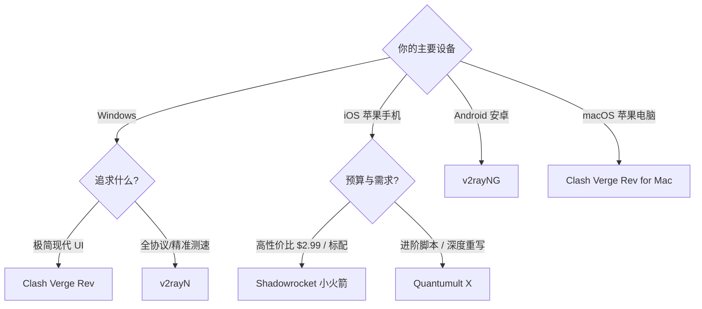

# 如何选择适合自己的客户端？

<AnswerBox question="不同操作系统最推荐的客户端是什么？">
Windows 推荐 **Clash Verge Rev**（现代界面、TUN模式）或 **v2rayN**（全协议兼容）；macOS 推荐 **Clash Verge Rev** 或 **Surge**；iOS 推荐 **Shadowrocket**（小火箭）；Android 推荐 **v2rayNG**。
</AnswerBox>

---

## 🧭 决策树与推荐矩阵

