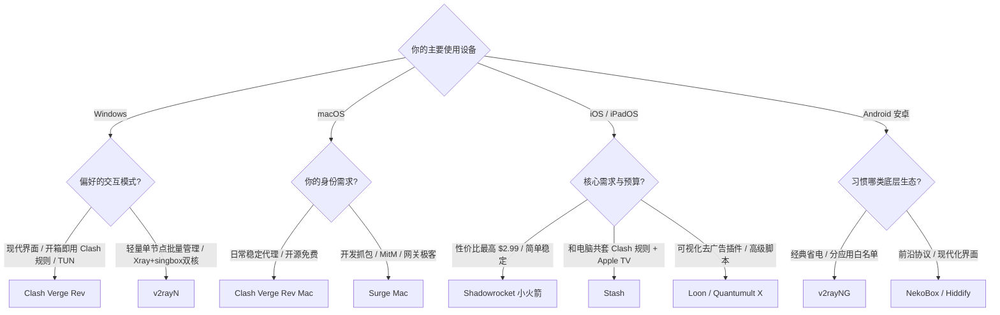

# 如何选择适合自己的代理客户端？- 跨平台决策指南

<AnswerBox question="不同系统设备，2026 年最推荐优先安装哪几款主流客户端？">
一句话懒人抄作业清单： 
• <strong>Windows / macOS</strong>：主流首选 <strong>Clash Verge Rev</strong>（界面美观、开箱即用分流）；传统极客备选 <strong>v2rayN</strong>；Mac 专业开发调试抓包选 <strong>Surge</strong>； 
• <strong>iOS (iPhone / iPad)</strong>：绝大多数新手选 <strong>Shadowrocket（小火箭）</strong>；需完整继承电脑 Clash 规则或配 Apple TV 选 <strong>Stash</strong>；爱折腾插件选 <strong>Loon / Quantumult X</strong>； 
• <strong>Android (安卓)</strong>：轻量经典选 <strong>v2rayNG</strong>；前沿协议/sing-box 选 <strong>NekoBox / Hiddify</strong>。
</AnswerBox>

---

## 一、跨平台决策树一览

---

## 二、五大主力系统客户端深度横评对照表

| 软件名称 | 适用系统 | 费用情况 | 底层内核 | 首选订阅格式 | 站内专项图文入口 |
| :--- | :--- | :--- | :--- | :--- | :--- |
| **Clash Verge Rev** | Win / macOS / Linux | 免费开源 | Mihomo (Meta) | Clash YAML | [Clash Verge 完整教程](/clients/clash-verge/) |
| **v2rayN** | Windows (及新端支持) | 免费开源 | Xray + sing-box | Base64 通用 / URI | [v2rayN 完整知识树](/clients/v2rayn/) |
| **Shadowrocket** | iOS / iPadOS | 外区买断 ~$2.99 | 自研混合 | 通用 Base64 / QR码 | [小火箭完整知识树](/clients/shadowrocket/) |
| **Stash** | iOS / macOS / tvOS | 外区买断付费 | 兼容 Clash 生态 | **Clash YAML** | [Stash 苹果专题](/clients/stash/) |
| **Loon / Quantumult X** | iOS | 外区买断付费 | 独立核心 | 各端专属模板或重写 | [Loon](/clients/loon/) ｜ [圈X](/clients/quantumult-x/) |
| **Surge** | macOS / iOS | 高阶商业授权 | 自研企业级 | Surge `.conf` | [Surge 调试与组网专题](/clients/surge/) |
| **v2rayNG** | Android | 免费开源 | Xray-core | Base64 通用 | [v2rayNG 安卓指南](/clients/v2rayng/) |
| **NekoBox** | Android / Windows | 免费开源 | **sing-box** | sing-box JSON / 通用 | [NekoBox 教程中心](/clients/nekobox/) |
| **Hiddify** | Win / Mac / iOS / Android | 免费开源 | **sing-box** | JSON / Clash / Base64 | [Hiddify 全端中心](/clients/hiddify/) |

---

## 三、选完软件之后你还要注意这两件事

1. **格式匹配不混淆**：桌面装好 Clash Verge 就不要把纯 Base64 订阅贴进去；手机装完 v2rayNG / Shadowrocket 就切回拿服务商后台给的通用 Base64 / 小火箭订阅。详情核对 [订阅格式全景区别](/subscription/formats)。
2. **远离山寨客户端下载站**：严禁在第三方中文搜索下载站点获取不知名“优化修改版、汉化破解版”；所有开源桌面/安卓软件必须认准官方 GitHub Release 或正规机场后台指引通道；苹果端则全部从海外区官方 App Store 正规购买下载。

---

## 常见问题解答（FAQ）

### Windows 电脑端选 Clash Verge Rev 还是 v2rayN 更好？

追求现代简洁卡片式图形界面、直接套用机场原生 Clash 分流规则、并需要便捷一键 TUN 模式推荐首选 [Clash Verge Rev](/clients/clash-verge/)；偏好极其轻量小巧、对单节点批量导入与 `Ctrl+R` 真连接快捷键顺手的老用户则可选 [v2rayN](/clients/v2rayn/)。

### iPhone 手机值得买贵一点的 Surge / Quantumult X，还是直接买最便宜的小火箭 Shadowrocket？

90% 的普通 iPhone 用户买 $2.99 的 [Shadowrocket](/clients/shadowrocket/) 就已经足够好用；需要原生导入桌面同款 Clash YAML 配置或带给 Apple TV 用选 [Stash](/clients/stash/)；仅重度规则脚本或开发调试才需要 [Loon](/clients/loon/)、[Quantumult X](/clients/quantumult-x/) 或 [Surge](/clients/surge/)。

### 有没有一套电脑、iPhone 和安卓界面完全一模一样、懒得分别学的软件？

基于 `sing-box` 打造的跨平台工具 [Hiddify](/clients/hiddify/) 主打全系统一致性极简界面，导入链接极快，只是进阶策略可控度不如 Clash 生态丰富。
