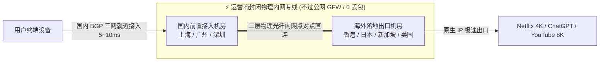

# IEPL 内网专线技术深度解析与实战选型

<AnswerBox question="什么是 IEPL 专线？为什么优质机场都标配 IEPL 内网专线？">
IEPL（International Ethernet Private Line，国际以太网私网专线）是<strong>跨国电信运营商（如中国移动国际 CMI、中国电信国际 CTG、PCCW）提供的二层以太网物理点对点内网专线通道</strong>。
数据在国内机房接入后，直接在运营商封闭的物理光纤内网中跨境传输，<strong>全程完全不经过公网 GFW 防火墙与拥堵的民用国际出口</strong>，因此具备<strong>晚高峰恒定 0 丢包、延迟恒定平稳与完全免疫网络封锁</strong>的顶级特性。
</AnswerBox>

---

## ⚙️ 一、IEPL 内网专线物理网络拓扑

---

## 📊 二、IEPL 专线 vs 公网中转 vs 公网直连实测指标全景对比

| 指标维度 | 公网直连 (163 骨干网) | 公网加密中转 (Transit) | 企业级 IEPL 物理专线 |
| :--- | :--- | :--- | :--- |
| **跨国链路属性** | 普通公网国际出口，过 GFW | 公网加密隧道，过 GFW | **运营商二层物理内网，不过 GFW** |
| **晚高峰丢包率** | 20% ~ 50% (严重拥堵) | 2% ~ 8% (偶有公网抖动) | **恒定 0.0% ~ 0.2%** |
| **网络抖动 (Jitter)** | $> 50\text{ ms}$ (剧烈波动) | $10\sim25\text{ ms}$ | **$< 1\text{ ms}$ (媲美局域网)** |
| **敏感时期可用性** | 极易被大面积阻断 | 需频繁更换中转跳板 | **🏆 100% 永不断连 (物理隔离)** |
| **运营商 QoS 限制** | 晚高峰遭遇严厉限速 | 受到中等程度公网挤压 | **完全不受民用公网限速影响** |
| **适用核心场景** | 仅适合应急备用 | 日常网页与流媒体 | **外服游戏联机、Zoom 会议、4K/8K 极客** |

---

## 🎯 三、如何精准辨别“真假 IEPL 专线”？

市场上部分不良商家会使用普通公网中转冒充 IEPL 专线，可以通过以下两招技术手段辨别：

1. **晚高峰 20:00~23:00 连续 MTR 丢包测试**：
   - 真实的 IEPL 专线在晚高峰时期 Ping 连续发包 100 次，丢包率仍然是绝对的 **0%**；
   - 假专线（公网中转）在晚高峰由于公网出口拥堵，丢包率会上升到 5%~15% 以上。
2. **路由追踪 (Traceroute) 内网跳数特征**：
   - 专线在内部转发时仅显示 1~2 跳局域网私有保留 IP（如 `10.x.x.x`），绝不会出现公网骨干网路由跳数。

---

## 🌟 四、2026 标配全企业级 IEPL 物理专线旗舰机场推荐

选择具备老牌稳定运营历史、全线标配企业级 IEPL 专线与 VLESS 协议的旗舰服务商：

<AirportCard v-if="guangsu" :airport="guangsu" />
<AirportCard v-if="sogo" :airport="sogo" />
<AirportCard v-if="civet" :airport="civet" />

---

## 📚 关联技术图谱
- [IPLC 物理专线技术深度解析](/network/iplc)
- [IEPL 和 IPLC 有什么区别？深度差异对比](/network/iepl-vs-iplc)
- [全 IEPL 专线高端机场专题推荐](/recommend/iepl-airports)
- [2026 机场综合排行榜](/navigation/ranking)
