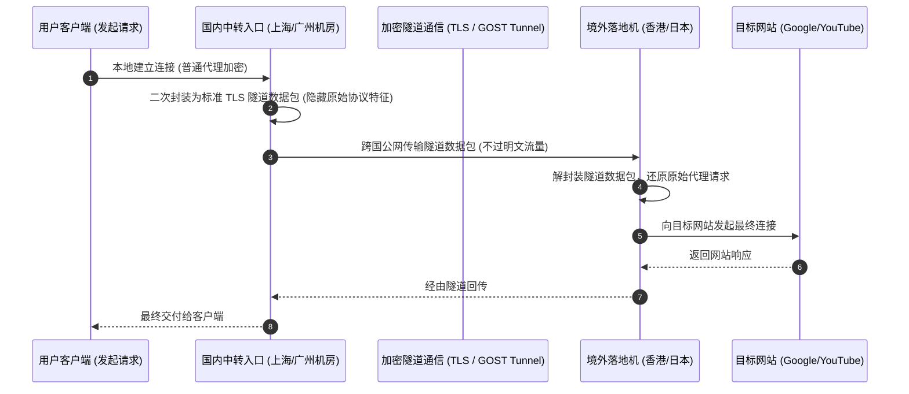

# 中转线路技术原理详解与实战选型

<AnswerBox question="什么是中转线路？它与公网直连和专线有什么区别？">
中转线路是指<strong>在用户和境外落地服务器之间搭建国内前置跳板机，并通过专有的双向加密隧道协议（如 GOST、TLS Tunnel、Wstunnel）进行跨界数据转发的技术架构</strong>。
它将不稳定的跨国公网拆解为“国内高速连接 + 加密跨界传输”，兼具了<strong>远超直连节点的抗封锁性与远低于物理专线的亲民成本</strong>，是追求高性价比用户的黄金折中方案。
</AnswerBox>

---

## ⚙️ 一、中转隧道的数据流向与封装过程

---

## 🆚 二、中转 vs 专线 vs 直连全景对比表

| 指标维度 | 公网直连节点 | 普通公网加密中转 | IEPL / IPLC 物理专线 |
| :--- | :--- | :--- | :--- |
| **跨国链路属性** | 普通公网国际出口，过 GFW | 公网加密隧道，过 GFW | **运营商二层物理内网，不过 GFW** |
| **抗封锁能力** | 极弱（极易被主动探测封 IP） | **强（流量被隧道 TLS 二次伪装）** | **极强（物理隔离，永不被封）** |
| **晚高峰稳定性** | 极差（丢包率 20%~50%） | **良（偶有公网抖动 2%~5%）** | **🏆 极致稳定（恒定 0 丢包）** |
| **采购与使用成本** | 最低（白菜价） | **适中（月付 10~20 元高性价比）** | 较高（高端商务与游戏首选） |
| **适用人群** | 仅适合应急备用 | **广大学生党与追求性价比用户** | **主力办公、外服联机、4K 极客** |

---

## 🌟 三、2026 高性价比中转与专线混合机场推荐

<AirportCard v-if="yuzhou" :airport="yuzhou" />
<AirportCard v-if="v2yun" :airport="v2yun" />
<AirportCard v-if="guangsu" :airport="guangsu" />

---

## 📚 关联技术图谱
- [IEPL 物理专线技术深度解析](/network/iepl)
- [BGP 动态多线接入机制](/network/bgp)
- [便宜高性价比月付机场推荐](/recommend/cheap-airports)
