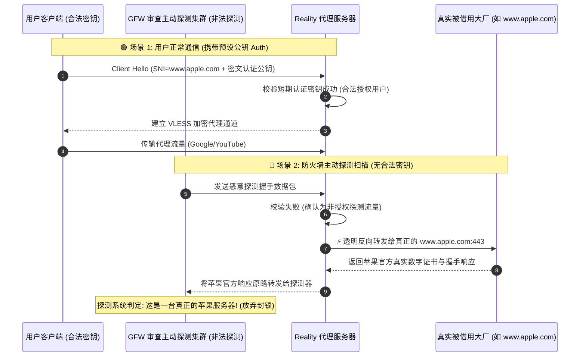

# Reality 协议底层技术解析与实战指南

<AnswerBox question="什么是 Reality 协议？为什么说它是目前公网伪装抗封锁的巅峰技术？">
Reality 是由 Xray 团队提出的一项<strong>突破性 TLS 流量伪装技术</strong>。
它彻底颠覆了传统代理必须“自行购买域名 + 申请 SSL 证书”的繁琐流程，<strong>允许服务器直接借用（偷取）全球合规知名大厂（如 www.apple.com、www.microsoft.com、www.amazon.com）的真实 TLS 证书与 SNI 握手</strong>。
当外部防火墙或主动探测系统尝试扫描服务器时，Reality 会直接将连接反向透明代理给真正的目标大厂，使审查系统抓不到任何代理特征，实现极强的抗封锁伪装。
</AnswerBox>

---

## ⚙️ 一、Reality 双向握手与抗主动探测防御时序图解



---

## 🔬 二、Reality 的三大核心优势

1. **彻底免除域名购买与证书续期维护**：
   - 传统 Trojan/VMess-TLS 需要用户购买独立域名并每 90 天续期 Let's Encrypt 证书；
   - Reality **无需域名、无需证书**，服务端只需指定一个海外主流大型白名单网站作为 Target SNI 即可。
2. **彻底免疫 TLS 证书与 SNI 关联封锁**：
   - 过去 GFW 会通过爬虫扫描机房所有 IP 的证书 SAN 域名进行批量封禁；
   - Reality 呈现给外界的证书与苹果/微软官网完全一致，审查系统无法将其拉入黑名单。
3. **消除中间人攻击 (MITM)**：
   - 基于非对称密钥认证，客户端在握手第一步就校验了服务器的私钥签名，任何伪造证书的审查中间人都会被客户端直接拒绝。

---

## 🖥️ 三、客户端 Reality 标准配置解剖

以 **Clash Verge Rev (Mihomo 内核)** 节点参数为例：

```yaml
proxies:
  - name: "🇯🇵 光速云-东京专线 (Reality)"
    type: vless
    server: 104.28.19.45
    port: 443
    uuid: 8a7c29e8-4f3d-4abb-d10c-1fb07c9c0001
    network: tcp
    udp: true
    tls: true
    flow: xtls-rprx-vision
    servername: www.apple.com  # 借用的大厂 SNI 白名单
    reality-opts:
      public-key: x7bF9P8zK2mW...  # 服务端公开密钥
      short-id: 01af23            # 授权识别短 ID
    client-fingerprint: chrome    # 模拟真实 Chrome 浏览器 uTLS 指纹
```

---

## 🛠️ 四、常见 Reality 配置报错排查

| 常见报错提示 | 故障根因分析 | 30 秒排查解决方案 |
| :--- | :--- | :--- |
| **`reality: invalid public key`** | 客户端填写的公钥与服务端不匹配 | 检查并重新导入机场提供的最新订阅配置 |
| **`handshake fail: remote server closed connection`** | 借用的目标大厂域名不支持 TLS 1.3 / H2 | 更换 target 域名为 `www.apple.com` 或 `addons.mozilla.org` |
| **`unsupported client fingerprint`** | 客户端不支持 uTLS 指纹伪装 | 在设置中将 `client-fingerprint` 指定为 `chrome` 或 `safari` |

---

## 🌟 五、2026 标配 Reality 协议的高抗封锁专线机场推荐

<script setup>
import { airportsData } from '../.vitepress/data/airportsData'
const guangsu = airportsData.find(a => a.id === 'guangsuyun')
const yuzhou = airportsData.find(a => a.id === 'yuzhoucloud')
const civet = airportsData.find(a => a.id === 'civetnet')
</script>

<AirportCard v-if="guangsu" :airport="guangsu" />
<AirportCard v-if="yuzhou" :airport="yuzhou" />
<AirportCard v-if="civet" :airport="civet" />

---

## 📚 关联技术图谱
- [VLESS 协议与 XTLS-Vision 技术解析](/protocols/vless)
- [GFW 防火长城主动探测机制深度科普](/glossary/gfw)
- [Clash / Mihomo 现代内核百科](/glossary/clash-core)
- [2026 机场综合排行榜](/navigation/ranking)
