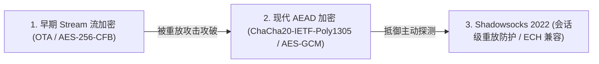

# Shadowsocks 协议深度解析与 2026 现状

<AnswerBox question="什么是 Shadowsocks (SS)？为什么在公网被识别的情况下，高端 IEPL 专线依然首选 SS？">
Shadowsocks 是由 <strong>clowwindy 于 2012 年开源的经典轻量级安全 SOCKS5 代理协议</strong>。
在公网环境下，由于其完全随机的加密密文缺乏真实 TLS 握手特征，容易被 GFW 机器学习分类器识别；
但在 <strong>全 IEPL / IPLC 物理专线架构下（数据在运营商内部私网传输，完全不过 GFW）</strong>，Shadowsocks <strong>极简的头部开销、超低握手延迟与极低的 CPU 占用</strong>，使其成为各大顶级商业专线机场效率最高的黄金协议。
</AnswerBox>

---

## ⚙️ 一、Shadowsocks 协议演进三大阶段



1. **AEAD 认证加密（现代基石）**：引入消息认证码（MAC），确保数据包在传输过程中**绝对不可篡改与伪造**，彻底修复了早期流加密的重放漏洞。
2. **Shadowsocks 2022 新规范**：
   - 采用标准固定长度请求头与时间戳防重放机制；
   - 提供了更严格的握手校验与更好的软硬件加速支持。

---

## 🆚 二、为什么高端 IEPL 专线偏爱 Shadowsocks？

| 对比维度 | 公网环境下的 Shadowsocks | 物理专线 (IEPL/IPLC) 下的 Shadowsocks |
| :--- | :--- | :--- |
| **面对 GFW 审查** | 容易因完全随机熵值被阻断 | **完全不过 GFW，根本不存在被封风险** |
| **连接建立延迟** | 需公网握手 | **0 额外握手开销，物理直通** |
| **设备 CPU 占用** | 低 | **极低（几乎所有软路由与手机均有硬件 AES 加速）** |
| **并发吞吐能力** | 一般 | **🏆 极限千兆跑满，吞吐性能之王** |

---

## 🖥️ 三、客户端 YAML 标准配置示例 (Clash Verge / Mihomo)

```yaml
proxies:
  - name: "🇭🇰 光速云-香港IEPL 01 (SS)"
    type: ss
    server: hk01.guangsuyun.vip
    port: 8388
    cipher: 2022-blake3-aes-128-gcm  # 现代 SS-2022 加密算法
    password: "user-token-secret"
    udp: true
```

---

## 🌟 四、2026 标配 IEPL + 极速 Shadowsocks 专线机场推荐

<script setup>
import { airportsData } from '../.vitepress/data/airportsData'
const guangsu = airportsData.find(a => a.id === 'guangsuyun')
const sogo = airportsData.find(a => a.id === 'sogoyun')
</script>

<AirportCard v-if="guangsu" :airport="guangsu" />
<AirportCard v-if="sogo" :airport="sogo" />

---

## 📚 关联技术图谱
- [IEPL 物理专线原理解析](/network/iepl)
- [VLESS 协议技术深度解析](/protocols/vless)
- [2026 机场综合口碑排行榜](/navigation/ranking)
