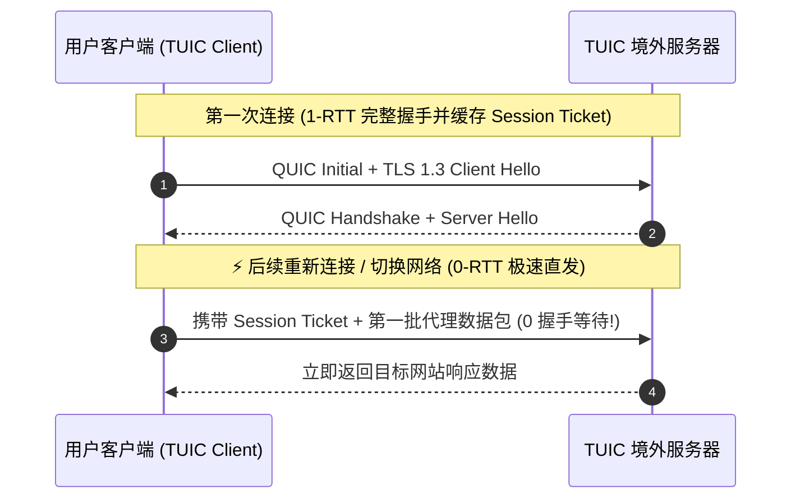

# TUIC v5 协议技术深度解析与实战指南

<AnswerBox question="什么是 TUIC 协议？它与 Hysteria 2 有什么核心区别？">
TUIC（基于标准 QUIC 协议重构的代理协议）由 EAimTY 开发，旨在<strong>在标准的 IETF QUIC 协议之上构建极致低首包延迟、支持 0-RTT 极速重连与原生多路复用的代理通道</strong>。
与 Hysteria 2 采用“暴力发包 Brutal 算法”不同，TUIC <strong>严格遵循标准 QUIC 协议与标准 BBR 拥塞控制</strong>，在不抢占恶劣带宽资源的前提下，提供最平滑的握手延迟与极高的握手效率。
</AnswerBox>

---

## ⚙️ 一、TUIC v5 原生 0-RTT 握手时序图解



---

## 🆚 二、TUIC v5 vs Hysteria 2 核心指标对比

| 技术维度 | TUIC v5 协议 | Hysteria 2 协议 |
| :--- | :--- | :--- |
| **底层协议基石** | **严格遵循标准 IETF QUIC (RFC 9000)** | 基于 QUIC 深度定制魔改 |
| **拥塞控制算法** | **标准 BBR / Cubic (网络友好型)** | **Brutal (强力速率控制, 暴力发包)** |
| **恶劣丢包抗压** | 良好（适合丢包率 $< 10\%$ 的网络） | **🏆 极强（丢包率 30% 依然拉满）** |
| **握手建立开销** | **0-RTT 极速恢复，移动端网络切换体验绝佳** | 1-RTT 标准握手 |
| **运营商 UDP 限速** | 容易被部分恶劣运营商 QoS 限制 | **支持端口跳跃 (Port Hopping) 突破** |

---

## 🖥️ 三、客户端 YAML 标准配置示例 (Clash Verge / Mihomo)

```yaml
proxies:
  - name: "🇸🇬 光速云-新加坡 (TUIC v5)"
    type: tuic
    server: sg01.guangsuyun.vip
    port: 8443
    uuid: 8a7c29e8-4f3d-4abb-d10c-1fb07c9c0001
    password: "token-auth-password"
    congestion-controller: bbr  # 拥塞控制算法
    udp-relay-mode: native       # 原生 UDP 转发
    zero-rtt-handshake: true    # 启用 0-RTT 握手
    sni: sg01.guangsuyun.vip
    skip-cert-verify: false
```

---

## 🌟 四、2026 标配现代 QUIC 协议的高速专线机场推荐

<script setup>
import { airportsData } from '../.vitepress/data/airportsData'
const guangsu = airportsData.find(a => a.id === 'guangsuyun')
const civet = airportsData.find(a => a.id === 'civetnet')
</script>

<AirportCard v-if="guangsu" :airport="guangsu" />
<AirportCard v-if="civet" :airport="civet" />

---

## 📚 关联技术图谱
- [Hysteria 2 协议魔改抗丢包解析](/protocols/hysteria2)
- [VLESS 协议与 XTLS-Vision 解析](/protocols/vless)
- [2026 机场综合口碑排行榜](/navigation/ranking)
