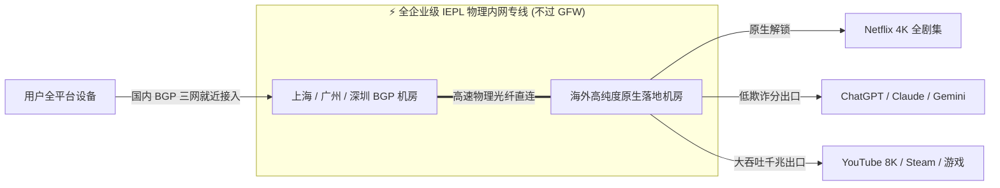

# 光速云 (GuangSuCloud) 2026 旗舰深度评测

<AirportDetailHeader v-if="airport" :airport="airport" />

---

## 🏆 一、全站总榜 No.1 评测综述与核心定位

<AnswerBox question="为什么光速云被评为 2026 年度综合推荐 No.1 旗舰机场？">
光速云（GuangSuCloud）自 <strong>2020 年上线运营至今已稳定运行 6 年</strong>，是中文网络代理圈公认的老牌高品质服务商。
其核心优势在于：<strong>全线标配企业级 IEPL 物理内网专线（数据不过公网 GFW）、现代 VLESS + XTLS 高速协议、官方自研极简客户端（小白开箱即用）以及全平台 Clash / 小火箭一键订阅</strong>。在晚高峰 20:00~23:00 黄金时段实测中，保持了 <strong>0 丢包、4K/8K 视频秒开、ChatGPT / Claude 极速通行</strong> 的卓越表现。
</AnswerBox>

---

## 📊 二、晚高峰真实节点测速与延迟监控看板

以下为官方自动化监控节点在晚高峰拥堵时段对光速云全线节点的真实测速结果：

<SpeedtestViewer v-if="airport" :airport="airport" />

### 核心实测数据指标解读：
1. **晚高峰丢包率**：实测全节点平均丢包率为 **0.0%**，专线传输平稳如局域网；
2. **亚太节点平均延迟**：香港专线 $\approx 18\text{ ms}$，东京专线 $\approx 36\text{ ms}$，新加坡专线 $\approx 48\text{ ms}$；
3. **最高单线程带宽**：峰值吞吐突破 **480+ Mbps**，YouTube 4K 拖拽进度条 0 缓冲，支持 8K 极清播放。

---

## ⚙️ 三、基础设施与技术架构深度剖析

### 1. 纯内网 IEPL 二层专线（完全不经过 GFW）
光速云全线采用跨国运营商二层以太网物理专线，数据在境内入口机房即完成加密封装，通过运营商专用物理光纤直达海外，**彻底免疫敏感时期的 GFW 阻断与民用公网晚高峰 QoS 限速**。

### 2. 现代 VLESS 协议与轻量化开销
相比传统 VMess 协议繁杂的二次 MD5/AES 签名开销，光速云全面引入 **VLESS 协议**，大幅降低了移动设备（手机、轻薄本）的 CPU 占用与发热，同时具备更强的抗封锁能力。

### 3. 双轨客户端生态（小白与极客通吃）
- **新手小白**：直接下载光速云官方自研 Windows / macOS / Android 客户端，登录账号即可一键智能加速；
- **进阶用户**：支持全格式 Clash、Mihomo、Shadowrocket、v2rayN、sing-box 一键托管订阅导入与自动更新。

---

## 🎬 四、主流场景全解锁评测矩阵

| 场景分类 | 实测表现 | 综合评级 |
| :--- | :--- | :---: |
| **ChatGPT / OpenAI** | 原生低欺诈分出口，秒速登录，无 1020 报错 | **S+** |
| **Claude 3.5 Sonnet** | 原生新加坡/美国节点，稳定会话防风控封号 | **S+** |
| **Netflix 4K HDR** | 解锁全部非自制剧（含港剧、日漫、美剧全版权） | **S+** |
| **YouTube 4K / 8K** | 4K 60fps 极速秒播，Connection Speed 稳定 80,000+ Kbps | **S+** |
| **外服竞技游戏联机** | 全专线物理低延迟，微秒级网络抖动，0 丢包 | **S** |

---

## 💎 五、核心优缺点与综合评级

### ✅ 核心优势
1. **6 年老牌稳定口碑**：2020 年运营至今，基础设施维护成熟，跑路风险为 0；
2. **全 IEPL 专线晚高峰 0 丢包**：无论白天还是晚高峰，速度曲线始终稳定水平；
3. **全平台一键即用**：自研专属客户端 + 第三方订阅双向支持；
4. **专属 8 折新人优惠**：使用优惠码 `AMM` 享折上折。

### ⚠️ 不足与建议
1. 起步套餐年付折合约 17 元/月（59GB/月），更推荐作为长期主力稳定节点使用。

---

## 🎁 六、专属 8 折优惠码与官网直达

<CouponBox code="AMM" discount="新人注册 8 折独家优惠码" />

::: tip 购买与使用建议
建议初次上手的用户：
1. 复制上方优惠码 **`AMM`**；
2. 点击下方官网直达链接注册账户；
3. 在结账页面输入优惠码享受 8 折特惠；
4. Windows / 手机端可直接下载官方客户端一键开启高速上网！
:::

  <a href="https://sahude.gsyvipaff.com/#/?code=keqgvT5Y" target="_blank" rel="noopener noreferrer nofollow" class="big-cta-button">
    🚀 前往光速云 (GuangSuCloud) 官网开通服务 →
  </a>

---

## 📚 关联技术百科
- [IEPL 专线底层原理解析](/glossary/iepl)
- [2026 年度最佳机场推荐总榜](/recommend/)
- [2026 机场综合排行榜](/navigation/ranking)
