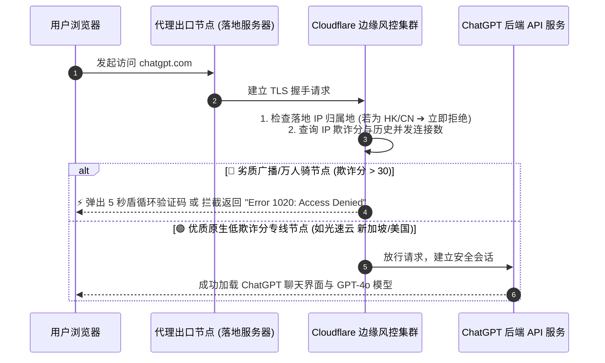

# ChatGPT / OpenAI 国内使用全攻略与 1020 报错排错指南

<AnswerBox question="国内怎么稳定使用 ChatGPT？为什么经常提示“Access Denied 1020”或“地区不支持”？">
国内使用 ChatGPT 的关键在于<strong>节点必须具备“高纯度原生 IP、低欺诈分（$< 15\text{分}$）且非香港/中国大陆出口”</strong>。 
OpenAI 接入了 Cloudflare 顶级风控体系：① <strong>官方屏蔽了中国香港 (HK) IP</strong>（连香港节点会直接提示 Not Available）；② <strong>万人共用的劣质机房节点会被判定为爬虫代理，直接拦截并报 1020 错误</strong>。 
解决核心：<strong>切换为新加坡 (SG)、美国 (US)、日本 (JP) 或台湾 (TW) 的原生 IEPL 专线节点</strong>。
</AnswerBox>

---

## ⚙️ 一、ChatGPT 访问全链路与 Cloudflare 风控拦截机理

---

## 🛠️ 二、ChatGPT 五大高频报错精准排查解决方案

### 1. 报错：`Access Denied (Error 1020)`
- **根本原因**：当前节点的落地 IP 被 Cloudflare 风控系统判定为恶意代理或高频并发 IP。
- **30 秒修复方案**：
  1. 打开客户端，切换为 **新加坡 (SG)、日本 (JP) 或美国 (US)** 的其他独立专线节点；
  2. 使用浏览器隐私无痕窗口重新打开 `chatgpt.com`。

### 2. 报错：`OpenAI's services are not available in your country` (地区不可用)
- **根本原因**：误选了 **中国香港 (HK)** 节点（OpenAI 官方从未对香港开放服务）。
- **30 秒修复方案**：在代理客户端中选择新加坡、美国、台湾或日本节点。

### 3. 报错：登录时一直转圈或卡在 Cloudflare 人机验证（死循环）
- **根本原因**：浏览器缓存了旧的失效 Cookie，或者 WebRTC 泄露了中国大陆真实 IP。
- **30 秒修复方案**：在浏览器设置中清除 `chatgpt.com` 的全部 Cookie 与缓存数据，或开启客户端 **[TUN 虚拟网卡模式](/glossary/tun-mode)**。

---

## 💡 三、ChatGPT 深度重度使用者的最佳节点选型指南

| 落地国家 / 地区 | 访问 ChatGPT 表现 | 推荐指数 | 适用场景 |
| :--- | :--- | :---: | :--- |
| **🇸🇬 新加坡 (SG)** | **速度极快，延迟低 (约 45ms)，官方完全开放** | ⭐⭐⭐⭐⭐ | **首选主力节点** |
| **🇺🇸 美国 (US)** | **原生 IP 纯净度最高，新功能首发支持** | ⭐⭐⭐⭐⭐ | 进阶功能、API 调用 |
| **🇯🇵 日本 (JP)** | **延迟极低 (约 35ms)，支持 GPT-4o 极速响应** | ⭐⭐⭐⭐⭐ | 日常办公对话 |
| **🇭🇰 中国香港 (HK)** | ❌ **官方直接屏蔽，提示地区不可用** | 🚫 **不可用** | 切勿用于 ChatGPT |

---

## 🌟 四、2026 ChatGPT / Claude AI 深度优化专线机场推荐

选择全线标配原生新加坡/美国低欺诈分专线、完美通行 ChatGPT 的旗舰级服务商：

<AirportCard v-if="guangsu" :airport="guangsu" />
<AirportCard v-if="sujie" :airport="sujie" />
<AirportCard v-if="civet" :airport="civet" />

---

## 📚 关联技术图谱
- [IP 欺诈分 (Fraud Score) 深度解析](/glossary/fraud-score)
- [Claude 封号与节点环境防坑指南](/scenarios/claude)
- [2026 ChatGPT 专用机场推荐专题](/recommend/chatgpt-airport)
- [2026 机场综合口碑排行榜](/navigation/ranking)
