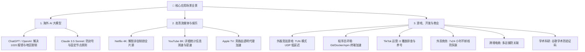

# 核心应用场景与专属解决方案全景百科 (Scenarios Hub)

<AnswerBox question="为什么不同场景对代理节点的要求天差地别？">
不同互联网业务的底层协议和风控逻辑截然不同： 
- <strong>ChatGPT / Claude</strong>：极度要求<strong>原生 IP 纯净度与低欺诈分</strong>； 
- <strong>Netflix / Disney+</strong>：极度要求<strong>本土 Whois 原生流媒体解锁</strong>； 
- <strong>外服联机游戏</strong>：极度要求 <strong>TUN 模式 UDP 转发与微秒级极低网络抖动</strong>； 
- <strong>YouTube 4K / 8K</strong>：极度要求<strong>单线程持续高带宽与 0 丢包率</strong>。
</AnswerBox>

---

## 🧭 一、核心场景需求全景导航矩阵

---

## 📑 二、核心场景独立专题目录

- **[ChatGPT / OpenAI 国内使用全攻略](/scenarios/chatgpt)**：1020 报错、地区不可用排查与原生专线节点。
- **[Claude 3.5 Sonnet 防封号实战指南](/scenarios/claude)**：账号被封原因分析与固定原生节点原则。
- **[Netflix 4K 流媒体全解锁指南](/scenarios/netflix)**：为什么只能看自制剧与全版权片源解锁技巧。
- **[YouTube 4K/8K 视频播放卡顿调优](/scenarios/youtube)**：详细统计信息解读与单线程提速。
- **[外服游戏联机加速实战](/scenarios/gaming)**：Steam/Apex/Valorant 低延迟与 TUN 模式配置。
- **[TikTok 跨境运营与 0 播放排查](/scenarios/tiktok)**：四步环境伪装与住宅 IP 养号。
- **[Apple TV 与电视盒子流媒体加速](/scenarios/apple-tv)**：旁路由透明代理与 tvOS 客户端配置。
- **[开发者与程序员代理加速实战](/scenarios/development)**：Git/Docker/npm 终端透明加速。
- **[外贸办公与客户沟通防失联指南](/scenarios/foreign-trade)**：WhatsApp/Gmail 高可用专线。
- **[跨境电商多店铺运营防关联指南](/scenarios/cross-border)**：独立 IP 与指纹浏览器实战。
- **[学术科研与文献检索实战指南](/scenarios/academic)**：谷歌学术异常流量验证码排查。

---

## 🌟 三、2026 全场景全能适配旗舰专线机场推荐

选择全线标配企业级 IEPL 专线、原生低欺诈分落地与 6 年稳定运营的旗舰服务商：

<AirportCard v-if="guangsu" :airport="guangsu" />
<AirportCard v-if="civet" :airport="civet" />
<AirportCard v-if="sogo" :airport="sogo" />

---

## 📚 关联知识图谱
- [2026 年度最佳机场推荐总榜](/recommend/)
- [核心代理协议全景技术百科](/protocols/)
- [2026 机场综合排行榜](/navigation/ranking)
