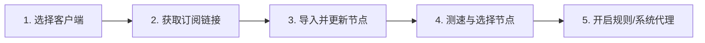

# 新手入门指南

<AnswerBox question="第一次接触网络代理工具，应该按什么顺序了解和操作？">
新手应当遵循「概念认知 → 客户端选择 → 订阅导入 → 节点测试 → 代理启用」五步流程。切忌在尚未理解订阅与节点区别前盲目修改系统网络配置。
</AnswerBox>

欢迎来到 JichangWiki 新手知识中心。网络代理工具并不是一个单一的黑盒软件，而是由**客户端工具**、**订阅配置**、**节点服务器**以及**传输协议**共同构成的协同系统。

为了帮助你建立清晰的认知并避免踩坑，我们整理了由浅入深的学习路径。

---

## 📚 核心概念快速索引

第一次接触相关概念时，建议按顺序阅读以下词条：

| 核心问题 | 知识点概要 | 学习入口 |
| :--- | :--- | :--- |
| **什么是机场？** | 提供聚合网络代理节点服务的服务商俗称，区别于传统 VPN。 | [阅读词条](/start/what-is-airport) |
| **什么是节点？** | 部署在境外的代理服务器实例，负责转发你的网络请求。 | [阅读词条](/start/what-is-node) |
| **什么是订阅？** | 将数十甚至上百个节点配置聚合为一个自动下发的 URL 地址。 | [阅读词条](/start/what-is-subscription) |
| **什么是代理？** | 为什么我们需要代理？正向代理与反向代理的基础工作模式。 | [阅读词条](/start/what-is-proxy) |

---

## ⚖️ 常见概念深度辨析

很多新手在配置出现问题时，往往分不清问题发生在客户端本地还是远端服务器。以下对比能帮你快速定位边界：

- **[机场与传统 VPN 的区别](/start/airport-vs-vpn)**：为什么机场更适合日常浏览、流媒体解锁，而企业 VPN 侧重内网加密通信？
- **[节点与订阅的区别](/start/node-vs-subscription)**：节点是具体的服务器，订阅是获取节点清单的通道，切勿混淆。
- **[客户端与订阅的关系](/start/client-vs-subscription)**：客户端是播放器，订阅是歌单；更换客户端不影响已有订阅。
- **[新手如何挑选适合的客户端？](/start/how-to-choose-client)**：根据 Windows、macOS、iOS 或 Android 平台选择最易上手的稳定工具。

---

## 🚀 新手起步标准五步法

1. **第一步：安装客户端**
   根据操作系统下载对应客户端。Windows 推荐 [Clash Verge Rev](/clients/clash-verge/) 或 [v2rayN](/clients/v2rayn/)；iOS 推荐 [Shadowrocket](/clients/shadowrocket/)；Android 推荐 [v2rayNG](/clients/v2rayng/)。
2. **第二步：导入订阅链接**
   复制服务商提供的订阅链接，粘贴到客户端的订阅管理模块并执行更新。
3. **第三步：选择延迟正常的节点**
   执行一键测速，优先选择物理距离近（如香港、日本、新加坡）且无丢包的节点。
4. **第四步：开启代理模式**
   推荐开启「规则模式 (Rule)」或「绕过大陆」，既保证国内网站直连不消耗流量，又能正常访问境外网络。
5. **第五步：验证连通性**
   打开浏览器访问测试网站，确认 IP 已经切换为落地节点属地。

---

## ❓ 常见新手疑问 FAQ

### Q1：为什么安装了客户端之后，电脑依然无法访问 Google？
安装客户端仅仅是在本地运行了一个路由转发进程。你必须先在客户端中导入有效的**订阅链接**，拉取节点列表，选中活动节点，并开启**系统代理**或 **TUN 模式**。

### Q2：节点全部显示 Timeout (超时) 是怎么回事？
首先检查你的电脑系统时间是否准确同步，误差超过 60 秒会导致 TLS 证书校验失败；其次排查订阅是否过期或流量已耗尽。详细排查请参阅 [节点全部超时解决方案](/troubleshooting/all-nodes-timeout)。
