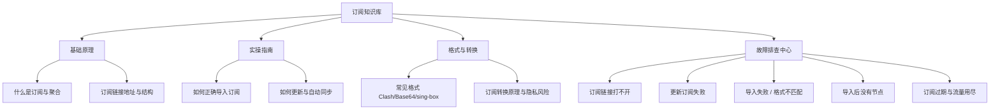

# 订阅知识库导读

<AnswerBox question="什么是订阅系统？为什么它是代理服务管理的核心纽带？">
订阅是将分散在世界各地的数十台服务器节点动态配置整合为一个集中托管的 **URL 网址**。它实现了节点信息的批量下发、自动维护、故障动态切换与用量信息回传。
</AnswerBox>

---

## 🌲 订阅知识体系全景

---

## 📑 订阅核心文章清单

- **[什么是订阅与节点聚合](/subscription/what-is-subscription)**：订阅在现代代理生态中的核心角色。
- **[订阅链接地址与结构解析](/subscription/subscription-url)**：URL 参数、Token 令牌与 Header 流量元数据。
- **[常见订阅格式全景对比](/subscription/formats)**：Clash YAML, Base64 URI, sing-box JSON 与 SIP002。
- **[订阅转换的原理与安全风险](/subscription/conversion)**：在线 Subconverter 转换器的运作逻辑与隐私泄露防范。
- **[如何正确导入订阅到各大客户端](/subscription/how-to-import)**：跨平台标准操作指引。
- **[如何更新订阅与设置自动策略](/subscription/how-to-update)**：保持节点信息时刻最新。
- **[订阅链接打不开排查](/subscription/url-not-working)**：404/500/SSL 错误快速定位。
- **[更新订阅失败排查](/subscription/update-failed)**：直连死锁与网络环境排查。
- **[导入后没有节点排查](/subscription/no-nodes)**：节点列表为空的深层原因。
- **[订阅过期与流量耗尽判断](/subscription/expired)**：快速核验账户状态。
