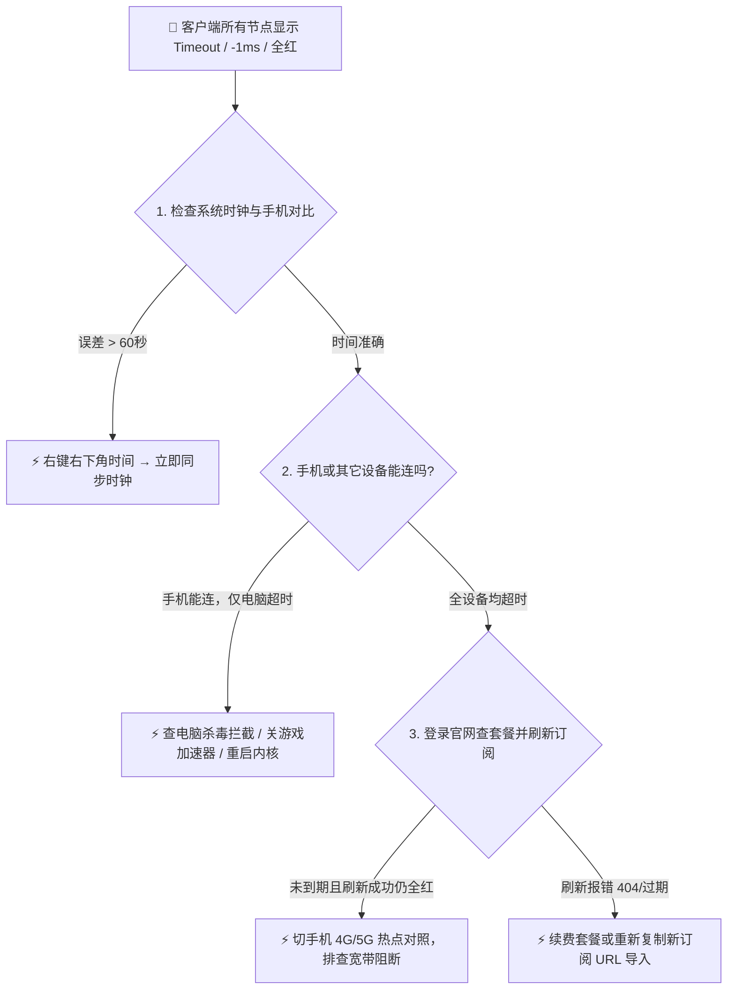

# 节点全部超时 (Timeout / -1ms / 全红) 诊断与 5 步修复

<AnswerBox question="为什么客户端里所有节点测速都显示 Timeout / 全红 / -1ms？">
节点全部超时并非节点一定全部宕机，按实际排查统计概率排序，五大主因如下：<br>
① <strong>本地系统时间误差超过 60 秒（最常见）</strong>：VMess / VLESS / TLS 握手严格校验时间戳，电脑时间不准会直接拒绝全部连接；<br>
② <strong>订阅已到期、流量用尽或曾重置过订阅链接</strong>；<br>
③ <strong>安全软件拦截了核心进程</strong>（如 Windows Defender / 火绒阻断了 `mihomo.exe`、`xray.exe` 联网）；<br>
④ <strong>本地宽带运营商阻断或 DNS 污染了节点入口域名</strong>；<br>
⑤ <strong>客户端同时存在多个代理工具造成端口或虚拟网卡冲突</strong>。
</AnswerBox>

---

## ⚙️ 一、30 秒快速自检排错流程图



---

## 💻 二、按客户端快速切入专属排查步骤

不同客户端的测速机制（URL Test vs ICMP Ping vs 真连接）和内核进程名不同，建议直接对照你使用的软件核对：

| 使用的客户端 | 最常见触发 Timeout 原因 | 专属细化排查手册 |
| :--- | :--- | :--- |
| **Clash Verge Rev** | 系统时钟偏差、`mihomo` 内核未放行、TUN 驱动与加速器冲突 | [Clash Verge 节点全部超时专属排查 →](/clients/clash-verge/node-timeout) |
| **v2rayN (Windows)** | 混淆 `Ctrl+P` 与 `Ctrl+O` 真连接测速、Xray 内核被杀软隔离 | [v2rayN 节点全部超时解决办法 →](/clients/v2rayn/node-timeout) |
| **Shadowrocket (小火箭)** | 全局路由误设为直连、未给蜂窝网络权限、Wi-Fi DNS 污染 | [Shadowrocket 节点全部超时排查 →](/clients/shadowrocket/node-timeout) |

---

## 🛠️ 三、通用 5 步根因定位与修复操作

### 第 1 步：立即校准本地系统时间（优先排查！）
现代代理协议（包括 VMess 的动态时间令牌验证以及 VLESS/Trojan 依赖的 TLS 握手）均要求客户端与远程服务器时钟高度一致。如果电脑装有 Windows/Linux 双系统、休眠唤醒或主板电池电量不足，极易产生几分钟甚至数小时偏差。
- **Windows 10 / 11**：右键右下角任务栏时间 ➔ 选择 `调整日期和时间` ➔ 开启 `自动设置时间` ➔ 点击 **`立即同步`**。若图形界面同步失败，可在管理员命令行执行：
  ```powershell
  w32tm /resync /force
  ```
- **macOS**：`系统设置` ➔ `通用` ➔ `日期与时间` ➔ 确保勾选 `自动设置时间与日期`。
- **iOS / Android**：打开系统「日期与时间」中的「自动设置」，确保时区为北京时间（UTC+8）。

### 第 2 步：核查机场账号状态并手动强制刷新订阅
即使订阅在客户端里依然能看到节点列表，只要机场后台更换了中转入口域名、重置了你的订阅 Token，或月度流量已经用尽，所有旧节点配置都会测速返回 `Timeout`。
1. 登录服务商官网用户中心，确认：**未到期、剩余流量大于 0**。
2. 在客户端中执行一次手动刷新订阅（参考 [Clash Verge 更新订阅教程](/clients/clash-verge/update-subscription) 或 [更新订阅失败排查](/troubleshooting/subscription-update-failed)）。

### 第 3 步：排查防火墙与安全软件静默拦截
Windows Defender、火绒、360 安全卫士等经常误杀或静默阻断代理工具后台拉起的核心二进制文件（例如 `clash-meta.exe`、`mihomo.exe`、`xray.exe`、`sing-box.exe`）。
- 症状：打开客户端界面正常，但一测速全是 Timeout，日志报错 `permission denied` 或无任何出站记录。
- 解决：打开安全软件的「隔离区/拦截日志」恢复对应核心文件，并将客户端所在文件夹整体加入「信任区 / 白名单」，然后重启客户端。

### 第 4 步：切换手机热点验证，识别宽带运营商阻断或 DNS 污染
连接家里宽带（尤其是部分地方宽带或校园网/公司内网）时，如果节点域名被本地运营商 DNS 劫持或拦截，客户端甚至无法解析出节点 IP。
- **验证方法**：电脑暂时断开宽带 Wi-Fi，改连手机 4G/5G 个人热点再点击一次测速。
- **判断结果**：如果切到手机热点后节点立刻恢复绿色延迟，说明问题出在当前宽带的路由器 DNS 或局域网防火墙限制。可在客户端基础 DNS 设置中使用国内公共 DNS（如 `223.5.5.5`）配合 DoH，详见 [DNS 解析错误排查](/troubleshooting/dns-error)。

### 第 5 步：关闭冲突的加速工具与重置本地网络栈
如果你同时开启了网易 UU、雷神等游戏加速器、企业 VPN、或旧版残留的代理软件，多个虚拟网卡与系统路由表会互相争夺流量出口。
- 请完全退出其它代理与加速器（注意检查任务栏右下角托盘区）；
- 在 Clash Verge 或 v2rayN 中先关闭 TUN 模式再重新开启，以重建干净的路由表。

---

## 🧪 四、修复后如何验证是否真正恢复？

不要只看测速界面某一个数字就下结论，建议完成以下两项实操验证：
1. **选择非 `-1ms` 的绿色/黄色真实延迟节点**：注意区分纯 TCP 握手测速与真实 URL 延迟测试（如测试 `https://www.gstatic.com/generate_204`），只有返回 HTTP 204 状态码与正常毫秒数才代表通道真正畅通。
2. **区分“节点 Timeout”与“高延迟飘红”**：如果节点能测出延迟但普遍高于 `500ms~2000ms` 飘红卡顿，不属于完全 Timeout，请参阅 [节点测速高延迟与丢包排查](/troubleshooting/nodes-red) 或 [节点延迟极高调优指南](/troubleshooting/high-latency)。

---

## ❓ 五、节点超时常见问题 FAQ

### Q1：为什么电脑上所有节点突然全部显示 Timeout 或 -1ms？
最常见原因是本地系统时间偏差超过 60~90 秒（常见于双系统切换或主板电池耗电），导致 TLS 证书与现代协议认证直接被拒；其次是订阅到期/流量耗尽、杀毒软件静默拦截内核出站，或服务商更换了入口域名而本地未更新订阅。

### Q2：手机连着同一个订阅能正常上网，为什么电脑端节点全部 Timeout？
当手机端可用而电脑端全红时，说明机场服务端与节点本身是正常的，问题 100% 出在电脑本地。请优先同步 Windows 系统时间，其次检查 Windows Defender / 火绒是否拦截了内核进程，以及电脑是否同时开着游戏加速器或旧版代理软件导致端口冲突。

### Q3：节点能测出绿色延迟数字，但浏览器依然打不开网页算 Timeout 吗？
不算节点超时，这属于“已连接但打不开网页”类路由或 DNS 接管问题。通常是因为忘记打开系统代理开关、TUN 网卡冲突或浏览器扩展劫持代理端口，可按 [已连接但打不开网页排查](/troubleshooting/connected-but-no-internet) 进一步排查。

### Q4：每次节点全部超时后把客户端重装有用吗？
绝大多数情况下重装客户端无效，因为系统时间偏差、订阅过期、运营商阻断或杀软拦截规则不会因重装而消失。按“时间同步 → 刷新订阅 → 杀软白名单 → 热点对照测试”顺序排查更快有效。
