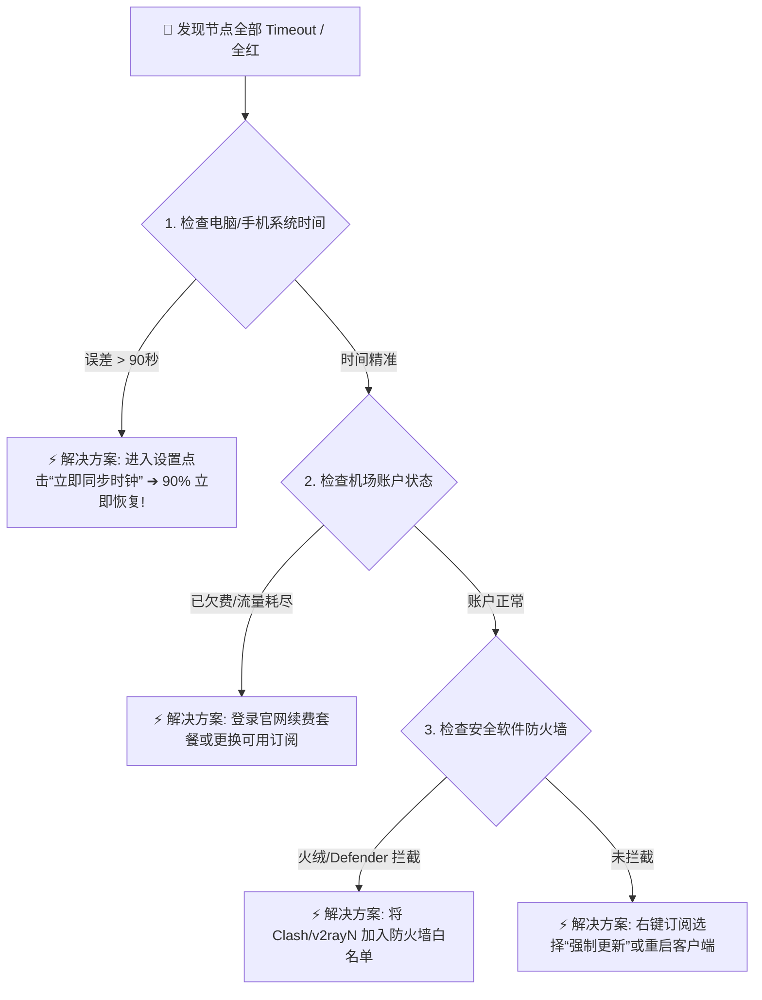

# 节点全部超时 (Timeout / 全红) 诊断与一键修复

<AnswerBox question="为什么客户端里的所有节点测速全部显示 Timeout（全红）？">
节点全部超时的五大核心根因（按发生概率排序）： 
① <strong>本地系统时间未同步（占 85% 案例）</strong>：VMess/VLESS 协议要求客户端与服务器时钟误差 $\le 90\text{秒}$，时间不对会直接拒绝所有握手； 
② <strong>订阅过期或流量耗尽</strong>； 
③ <strong>杀毒软件 / Windows Defender 拦截了客户端内核 (Core) 联网</strong>； 
④ <strong>机场节点域名遭到本地运营商 DNS 污染阻断</strong>； 
⑤ <strong>客户端配置文件 YAML 语法损坏</strong>。
</AnswerBox>

---

## ⚙️ 一、30 秒快速自检排错流程图

---

## 🛠️ 二、分步排查详细操作指南

### 1. 第一步：立即同步本地系统时钟（最关键！）
- **Windows 10 / 11**：
  1. 鼠标右键点击屏幕右下角的时间 ➔ 选择 `调整日期和时间`；
  2. 确保开启 `自动设置时间`；
  3. 找到并点击 **`立即同步`** 按钮，确保显示绿色勾选。
- **macOS**：
  1. 打开 `系统设置` ➔ `通用` ➔ `日期与时间` ➔ 开启 `自动设置时间与日期`。
- **iOS / Android 手机**：
  1. 进入手机系统设置 ➔ 打开 `自动设置时区与时间`。

### 2. 第二步：检查机场套餐有效期与剩余流量
登录机场官网用户中心，核实：
- 套餐是否已到期？
- 当月月度配额是否已用完？

### 3. 第三步：防火墙与杀毒软件白名单
部分杀毒软件（如 360、火绒、Windows Defender）可能会静默拦截 `mihomo.exe`、`clash-core.exe` 的网络出站权限。在防火墙允许应用列表中将其勾选允许通过专有和公用网络。

---

## 🌟 三、2026 标配高可用专线与多节点容灾机场推荐

选择全线标配企业级 IEPL 专线、多入口容灾与 6 年稳定运营的旗舰服务商：

<AirportCard v-if="guangsu" :airport="guangsu" />
<AirportCard v-if="civet" :airport="civet" />

---

## 📚 关联技术图谱
- [已连接但打不开网页排查](/troubleshooting/connected-but-no-internet)
- [更新订阅失败排查完整指南](/troubleshooting/subscription-update-failed)
- [2026 机场综合口碑排行榜](/navigation/ranking)
